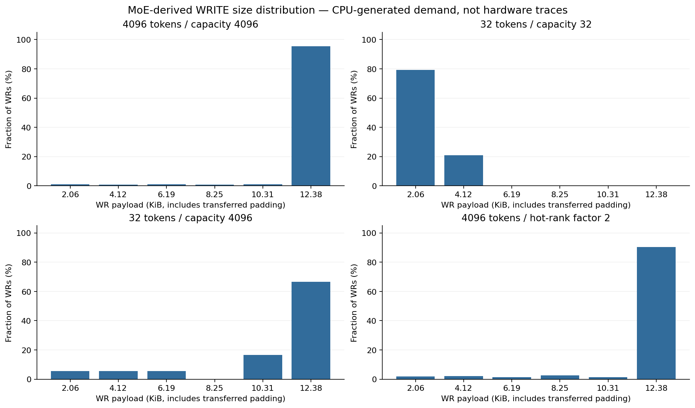
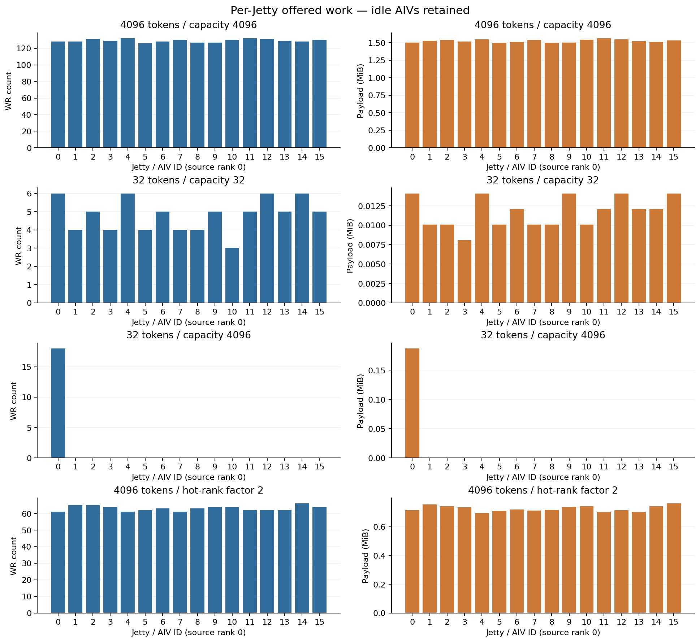

# Phase 1 短报告：MoE-derived WR 需求与通用接口

完成范围：Schema 1.0、严格验证器、Synthetic / CPU MoE Dispatch Generator、22 项单元测试、9 个可复现 trace 场景及分布图。**未实现 Phase 2 adapter，未运行新的调度性能实验，未推送远端。**

工作基线是 `9394048466813e747ca52a72ec0f0463a0c327c6`。源码证据固定到 DeepEP-Ascend `3b25377d04b24fc6154698ded78a2bcb2c59afff`；详见 [源码核验](SOURCE_EVIDENCE.md) 的 commit/行号链接和 SHA256。

## 主要发现

1. 在核验的 Dispatch 路径里，Pair 是同一 token-rank 拷贝的 hidden+metadata 两个 SGE，最多六对。但专家路由先按 rank 去重，**top-k 不等于网络副本数**；本地目的 rank 也不产生网络 WRITE。
2. 不是按计时器流式 flush。每个 AIV/远端 rank 的条目以六个为一组，末尾至多一组不满；SQE 写完、前置工作完成后才统一 doorbell。
3. 分区宽度为 `ceil(capacity/AIV)`，再裁到实际 tokens。配置容量会改变活跃 Jetty 数及聚合度，不能只记录实际 tokens。
4. 请求数量、大小及 peer 分组有明确源码依据；token/peer 原子预留的具体并发顺序没有确定保证。生成器用升序 token、循环 peer 的固定顺序作为近似，且将顺序假设写进 metadata。

## 通用接口

CSV 仅有版本、WR 身份、源/目标、Jetty、WRITE、payload、ready_ns、Jetty sequence、可选完成依赖及阶段。Jetty 身份是 `(src_node, jetty_id)`；WR ID 在全 trace 唯一。Schema 不放 policy、quantum、链路成本、Flit 或完成时间。验证器拒绝未知字段/版本、坏整数、乱序、重复 ID、错误 sequence 和非法依赖。

Payload 指实际转移的 SGE 数据，包含真的传送的布局 padding；侧车另外区分 semantic/padding、SGE 数与长度、token、路由和末 SQE 标志。网络线字节由未来后端定义，不能把 SQE 的 48 B header 或四个 WQEBB 算成网络封装。

MoE 代码仅依赖通用 Python 行对象，不依赖 Nano-UB。通用验证器完全不读取 MoE 参数。通用分布统计可处理 Synthetic；MoE 聚合统计只在有侧车时增加。详细契约在 [schema 文档](../../workloads/schema/README.md)。

## 固定案例与结果

以下统计的是**生成的通信需求**，不是硬件 trace，也不是 SystemC 测量。固定 seed=42、单源 rank 0、8 ranks、64 experts、top-k=4、16 AIV、hidden=1024 BF16 元素。每 Pair 为 2048 B hidden+64 B metadata=2112 B，满 WR 为 **12672 B**。元数据中含实际传送的 padding，每 Pair 非 padding 数据为 2100 B。

| 场景 | 实际 tokens / capacity | WR 数 | 活跃 Jetty / 16 | 总 payload B | 满六对 WR 比例 | 平均 Pair/WR |
|---|---|---:|---:|---:|---:|---:|
| 低 token、均匀 | 32 / 32 | 77 | 16 | 196,416 | 0% | 1.208 |
| 高 token、均匀 | 4096 / 4096 | 2066 | 16 | 25,559,424 | 95.35% | 5.858 |
| 高 token、倾斜 | 4096 / 4096 | 1009 | 16 | 12,167,232 | 90.49% | 5.710 |
| 低实际数、高容量 | 32 / 4096 | 18 | 1 | 196,416 | 66.67% | 5.167 |

高 token 均匀情况下，各 Jetty 的 WR 数仅 126–132，平均 Pair/WR 为 5.824–5.914，大小分布相近；**95.35% 已完全等长（12672 B）**。倾斜案例也有 90.49% 满 WR，但每 Jetty WR 数降为 61–66，平均 Pair/WR 为 5.591–5.906。低 token 案例每 Jetty 只有 3–6 个 WR，聚合主要是一至两对；它并不是每个 Jetty 拥有大量长期积压的“大/小 WR 两类流”。

倾斜使用 `score_factor=2, hot_rank=1`，对应 gate.py 的分数幅度机制，不是“流量两倍”。当前种子下热点目的 rank 的实际 payload 约为其他远端 rank 均值的 **14.69 倍**。同 rank 专家去重使总网络复制数也减少，因此不能把不同案例直接当相同工作量比较性能。该分布是公开测试生成方法的近似，不是校准后的真实模型路由分布。

低 token / 高容量场景保持 token 路由和总字节数不变，只改变 AIV 划分：仅 AIV 0 活跃，把原本 77 个分散小 WR 聚合成 18 个 WR。这样的单活跃 Jetty 场景本身没有多 Jetty 竞争。

逐值可查 `summary.csv`、`histograms.csv`、`jetty_histograms.csv`、`jetties.csv`、`destinations.csv`、`aggregation.csv`；所有零流量 Jetty 都保留在逐 Jetty 表和图中。另有满聚合比例图，三张图均有 PNG/PDF 版本。

这些分布提示：高 token 负载可能接近等长 WR，RR/DRR 的差异不能从先前人工混合负载直接外推。本阶段不作吞吐、尾延迟或调度获胜判断。

## ready_ns 的含义与敏感性

- Synthetic batch 全部在 start ready；burst 每个 Jetty 每 burst_size 个 WR 同时 ready，相邻 burst 间隔 burst_gap_ns。
- Synthetic Poisson 为每 Jetty 指数间隔，第一条也等待一次采样间隔；累计连续到达时刻向上取整到整数 ns，允许量化后的同刻请求。seed 固定，生成器不参考任何调度器状态。
- MoE 默认把门铃前工作折叠到 t=0，每个 AIV 的所有已构造 WR 一批 ready。这是“共同门铃就绪时刻”的敏感性起点，不是 kernel 开始到就绪的实测耗时。
- MoE 可用 `start_ns + aiv*stagger_ns + owned_tokens*prep_ns` 表达假设的各 AIV 门铃就绪偏移；不按该时间重新切分六对聚合。
- 高 token 到达敏感性案例取 stagger=100 ns、prep=10 ns/token，得到各 Jetty ready 时刻 2560–4060 ns，WR 数、大小和聚合统计与 batch 完全相同。这些数字是人工输入，未运行任何对应模拟器实验。

真实 barrier、metadata MTE、local copy、统计通知和原子竞争耗时都没有测量。生成器检查了类型、路由和 SQ 等边界，但不完整校验所有 NPU UB-buffer 编译限制，不是硬件配置合法性认证器。用户将来可替换 Generator 或输入实测 ready_ns；当前 CSV 不能标为 hardware trace。

## 验证与可复现性

22 项测试通过，包括：

- 通用 schema / JSON 约束一致性、CSV round-trip、空输入、节点内 Jetty 命名空间、未知字段/版本、坏数值、依赖/顺序失败检查。
- Synthetic 等长/混合负载与原 768 WR 基线中的 ID、Jetty、sequence、大小、提交时刻逐项对齐；batch/burst/Poisson 及 seed 检查。
- 源码已核验的 BF16/FP8 字节公式；同 rank 专家去重；local-only；六对满组和尾组；不得跨 AIV/peer 合并；capacity 分区尾部及闲置 AIV；多源全局 ID。
- token-rank 对集合无丢失/重复；remote pair 数和字节守恒；SGE 长度和语义/padding 守恒；非法配置、SQ 深度最坏占用边界；损坏侧车被拒绝。
- 同 seed 的 CSV、metadata、SGE 侧车及路由侧车逐字节一致；4096 token 场景额外在新路径独立运行后 `cmp` 全部通过。不同 seed 会改变路由。保证针对相同配置及受测 Python 3.12.14，不声称跨 NPU RNG 一致。

复现入口：`./experiments/phase1/run.sh`。只需要 Python 标准库；图表另需 Matplotlib 3.10.8。脚本不调用 SystemC、CMake 或调度 benchmark。固定源码复核：`python3 experiments/phase1/verify_source.py <固定提交的本地 DeepEP-Ascend 路径>`。

基线文件全部按 Git 原始 blob 核验，不改变原 15 CTest、16 E2E 代码/数据，不重复执行调度性能实验。证据见 `experiments/phase1/output/baseline_preservation.json` 和 `source_verification.json`。本阶段测试日志在 `output/tests.txt`，不是原 E2E 的测试报告。

## Phase 2 接入障碍（本次不实施）

- 现有场景硬编码三 Jetty、单源/目标、单 TP 通道，且 rc_id=1..N；通用节点/Jetty ID 与多个目的 rank 需要显式映射，不能直接塞进 rc_id。
- 当前 1 MiB 目标内存和实验侧 payload 存储不足以直接容纳高 token 例的 25.6 MB 数据；必须重新定义地址/数据生命周期及资源限制。通用 v1 不含地址或 rkey。
- `ready_ns`、队内提交顺序、可选完成依赖需要明确处理；不能把所有 CSV 行在 t=0 注入后仍宣称 arrival model 生效。
- 当前 WR 原子传输、64 B 假设头部以及 ACK 每 WR 完成，与 DeepEP 的多个 SGE、末 SQE fence/CQE 和可能的真实分段不是同一协议覆盖。通用 trace 没有伪造这种等价；若要研究这些传输语义，应先扩展契约，不能静默忽略侧车标志。
- 单源子集的 trace 不等于全部 ranks 的完整 collective。控制信号、本地拷贝和门铃前计算目前仅解释来源/就绪假设，不是 Simulator 中的 DeepEP 专用模块。

Phase 1 在此停止，等待审查。
