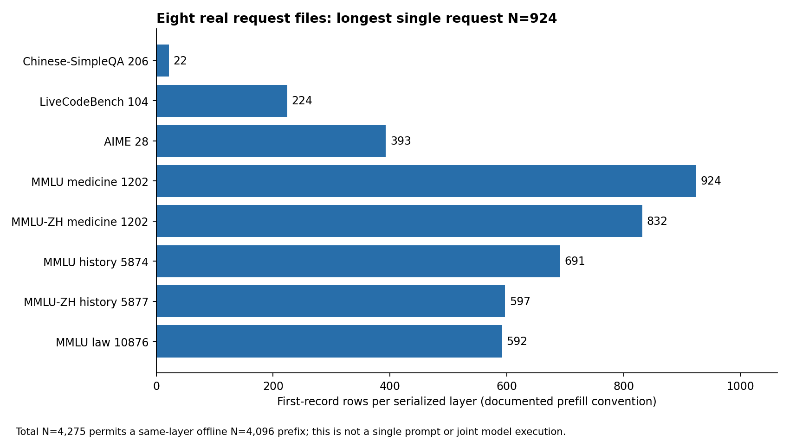
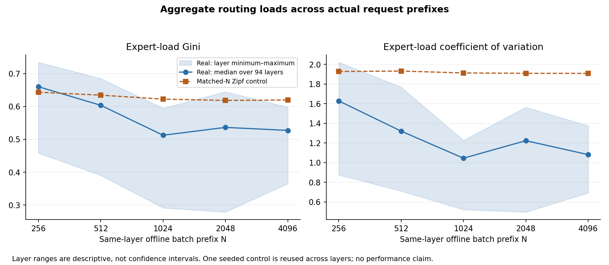
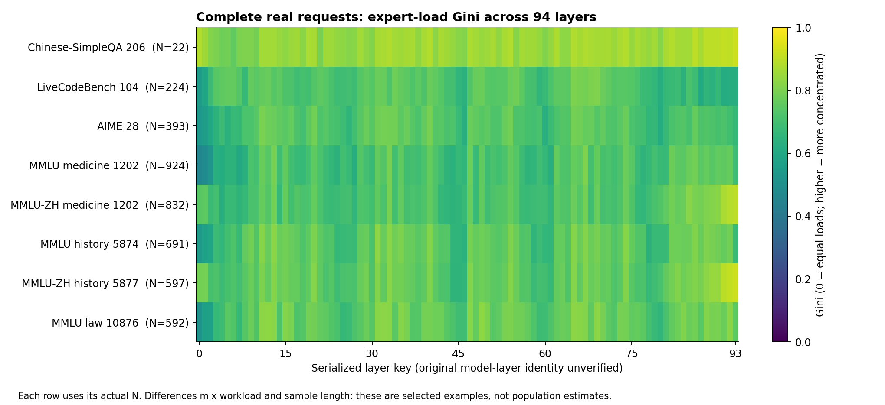

# Qwen3-235B-FP8 real request-length survey and bounded sample expansion

## Result

Eight distinct, authorized request files provide **4,275 first-record rows per serialized layer**.
The longest observed single request has **924** rows. Single-request prefixes at N=256 and
512 are supported; N=1024, 2048 and 4096 are available only by composing distinct requests
at the same layer. A 4096-row offline batch is not a single 4096-token prompt, a jointly
executed model batch, or a model-performance measurement.

| Source under Qwen/Qwen3-235B-A22B-FP8 | First-record N | Later single-row records |
|---|---:|---:|
| Chinese-SimpleQA/中华文化/206.json | 22 | 54 |
| livecodebench/execution/104.json | 224 | 128 |
| HuggingFaceH4/aime_2024/28.json | 393 | 128 |
| mmlu/college_medicine/1202.json | 924 | 128 |
| mmlu_ZH_CN/college_medicine/1202.json | 832 | 128 |
| mmlu/high_school_world_history/5874.json | 691 | 128 |
| mmlu_ZH_CN/high_school_world_history/5877.json | 597 | 128 |
| mmlu/professional_law/10876.json | 592 | 128 |

Every file has 94 serialized layer keys and eight distinct in-range expert IDs per row.
The seven new downloads total 93,704,335 bytes; the original 1,485,105-byte N22 upload is
retained separately. Acquisition stopped as soon as the third final candidate brought the
available total above 4096. No whole-dataset download was performed.

`actual-sample-lengths.csv` records actual lengths, source paths, hashes and acquisition
status. The three candidate CSVs retain exact pinned URLs, byte counts, public blob IDs,
selection logic and measured N. The three `*-validation.json` files record parser and
identity checks. `length-availability.csv` separates single-request eligibility from
same-layer offline composition. No dataset-wide absence claim follows from eight files.

## Descriptive aggregate findings

At the N4096 offline prefix, the real 94-layer median Gini is 0.527210
(layer range 0.364832–0.597944), versus 0.619851 for the matched seeded Zipf control.
The median CV is 1.081520 (0.690920–1.376138), versus 1.907900; median maximum/mean
load is 5.925781 (3.324219–8.402344), versus 14.425781. These describe this ordered
mixture of eight selected requests. They do not establish a population advantage,
length-only causal effect, or performance gain. Prefix composition changes with N,
and the layer range is not a confidence interval; the same control is reused for all layers.

All three figures were generated from aggregate CSVs only and visually inspected for labels,
limits and completeness. No token-level routing is embedded in them.

## Public directory survey

Dataset: [core12345/MoE_expert_selection_trace](https://huggingface.co/datasets/core12345/MoE_expert_selection_trace),
pinned revision `27febb7b2d24169560a9f6f83d38eb53f94916cf`.
The complete immediate Qwen root contains Chinese-SimpleQA, HuggingFaceH4, livecodebench,
mmlu and mmlu_ZH_CN. There is no HellaSwag immediate child at this pinned root; this does
not imply absence under other models, revisions, or naming.

All five recursive inventories terminated without a next page: 29 pages including the root,
23,760 file entries and 78,186,671,944 summed listed file bytes. These metadata totals are
not required download volume. Counts are Chinese-SimpleQA 3,000; HuggingFaceH4 30;
livecodebench 479; mmlu 14,046; mmlu_ZH_CN 6,205. MMLU includes 14,042 JSON files and four
tar.gz archives; MMLU_ZH_CN has 6,205 JSON. File counts are not necessarily request counts,
and size sums can count both archives and their expanded counterparts. No archive was selected.

The initial root and first three recursive inventories (seven pages) completed before a
process interruption but retain summary-only observations in `prior-observations.json`.
Their original response bodies/page hashes were lost; none are fabricated. The remaining
22 pages retain response caches and SHA-256 in `inventory.json` and `metadata-pages/`.
The checkpointed collector bounds each inventory to 30 pages of at most 1000 entries,
all inventories to 80 pages, each response to 4 MiB, and free disk to at least 8 GiB.
`directory-coverage.csv` and `file-type-counts.csv` describe coverage and type distinctions.

## Selection and access

**File bytes are not prefill token lengths.** They reflect all recorded layers, prefill,
decode, serialization and integer widths. The largest coding and math files were prioritized
first; their measured N224/N393 motivated two large filename-aligned English/Chinese
knowledge examples. These share a filename/subject but semantic identity is not established
by routing data. Their N924/N832 still did not support a 4096-row offline batch, so at most
three further large history/law JSON candidates were selected, each downloaded and validated
before proceeding, with immediate stop at cumulative N4096. This is purposeful discovery,
not random sampling or a representative estimate of the dataset's length distribution.

The dataset is gated. The public `survey.py` makes only unauthenticated tree-metadata
requests; it never requests gated resolve/raw content, HEAD or Range. After the user
completed official Hugging Face device authorization, the official CLI downloaded only
explicit filenames at the pinned revision into a private non-Git directory. No credential
contents or authentication headers are present in this report or repository.

An initial CLI invocation with two filenames unexpectedly used snapshot-style repository
listing. It made no completed file download, encountered a server-disconnect retry, and was
safely interrupted (exit130). The corrected flow invokes one explicit filename per CLI call,
with a 300-second deadline per file. This avoided an unnecessary whole-repository listing.
No access rejection was bypassed, and no endpoint/network override was used.

## Validation, meaning and batch boundaries

The accepted `extract.parse` and independently implemented `independent_validator.read_source`
both checked every raw record: unique JSON keys, ordered layer keys 0..93, consistent row
counts, top-k eight, distinct integer expert IDs in 0..127, and expected record shapes.
Non-LFS raw Git blob hashes match public tree metadata. For LFS files, public LFS/Xet IDs
were masked; the actual SHA-256 and byte count reconstruct a standard LFS pointer whose
Git blob matches the public pointer blob. SHA values are retained for every private original.

The existing accepted dataset-card interpretation identifies record zero as prefill and
later records as decode; there are no embedded phase labels. Only first-record rows enter
the analysis. Token identifiers are serialized row ordinals, not tokenizer vocabulary IDs;
original tokenizer identity/order, model-layer correspondence and collection correctness
remain unverified beyond the preserved serialization.

Offline composition follows the table's fixed file order within each serialized layer;
request boundaries and row ordinals remain explicit. The first seven requests contribute
3683 rows, so the N4096 prefix takes exactly 413 rows from the final law request and leaves
179 of its prefill rows unused. No duplicate request, copied token, layer stacking, decode
concatenation or synthetic filling is allowed. Translated or related examples are separate
observed routing files, not a claim of independent semantic tasks.

The batch pipeline is under `experiments/qwen-real-length-survey/`. Private token-level
exports are deliberately limited to serialized layer 0; aggregate counts/statistics cover
all 94 layers. Dense public aggregate tables are losslessly gzip-compressed;
`aggregate-packaging.json` records both compressed and decompressed hashes, and the
experiment README provides a Python read example. See that experiment's README, provenance and checks for the completed
export readback, prefix validation and matched synthetic control. Synthetic routing is
labeled as a control only and never substituted into the real batch.

No simulator, Planner, Relay, placement, network, GPU execution, model-size or precision
configuration is changed. These routing observations do not establish throughput, speedup,
FP8/BF16 equivalence, or original batch-execution behavior.

## Reproduction and publication boundary

Run `python survey.py` here to reuse cached public metadata and retrieve missing pages;
summary-only prior observations are retained as such. Run `python check_survey.py` for
metadata/length-table consistency. Local inspection is implemented in
`experiments/qwen-real-length-survey/inspect_samples.py`; bounded acquisition is in
`acquire_bounded.py` and requires separately authorized CLI access and explicit private paths.
The batch README gives the private-manifest analysis command. Never use a public repository
as the destination for raw files or per-token CSVs.

The dataset's raw/per-token redistribution license remains unestablished. Public outputs
are original code, public directory metadata, exact paths, hashes, aggregate statistics
and figures only. Raw JSON, per-token routing CSVs and credential material stay private.
A model or code license does not establish this dataset's license.
