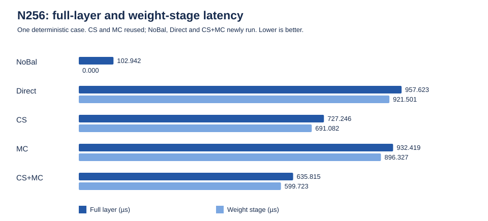
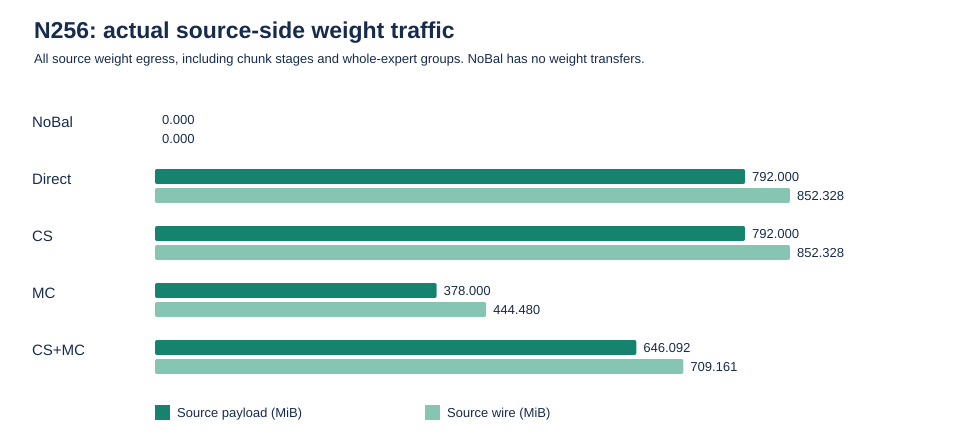
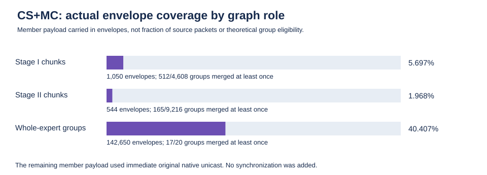

# CS + Multicast WRITE v2: N256 integration and performance

Application baseline: `3a33cc6a249667fc46bf02ac0fed4e1127d7c1ab`. Independent delivery branch: `experiments/chunk-streaming-multicast-dot-20261021`.

**Outcome:** the new nonblocking hybrid preserves the original CS graph and streaming dependencies. At the one fixed real Qwen3 L37 / EP64 / 256-token / 3136-Gbps point, it reduces Weight Duration by **13.22%** and Layer Latency by **12.57%** versus accepted CS. No Balancing remains fastest overall. No larger token experiments were run.

**Interpretation boundary:** 98.895% of observed envelopes belong to existing whole-expert CS fallback groups. Both relay hops genuinely multicast, but this experiment does not isolate their individual causal contribution.

Read [DESIGN.md](DESIGN.md), [NATIVE-PATCH.md](NATIVE-PATCH.md), [RUNTIME-SAFETY.md](RUNTIME-SAFETY.md), and [REPRODUCE.md](REPRODUCE.md). There is no new native protocol patch; the six inherited patches are pinned. Raw routing traces, per-token data and payload are not published.

## Formal results

## Result and scope

All five strategies passed at the single fixed 256-token point. NoBal, Direct and CS+MC were newly executed sequentially; the previously accepted CS and MC results were reused after exact input/native-library checks, twelve paired original-mode regressions and independent review. This is not a token sweep, stability study or crossover estimate.

| Strategy | Evidence | Full layer (µs) | Weight stage (µs) | Source weight payload (bytes) | Source weight wire (bytes) |
|---|---|---:|---:|---:|---:|
| NoBal | NEW | 102.942153 | 0 | 0 | 0 |
| Direct | NEW | 957.622688 | 921.500622 | 830,472,192 | 893,730,816 |
| CS | REUSED | 727.245670 | 691.082182 | 830,472,192 | 893,730,816 |
| MC | REUSED | 932.419197 | 896.326667 | 396,361,728 | 466,071,552 |
| CS+MC | NEW | 635.815360 | 599.722514 | 677,476,352 | 743,609,524 |

CS+MC reduces the weight-stage duration by **13.22%** and full-layer latency by **12.57%** relative to CS. Full-layer speedup over CS is 1.143800×. It is 33.60% below Direct and 31.81% below MC on layer latency. Its source payload and wire bytes fall 18.42% and 16.80% relative to CS, respectively. Downstream native weight wire bytes remain 893,730,816 across the balanced strategies.

**NoBal is still fastest overall at N256.** It intentionally has a main-only plan with zero replicas and no weight transfers; its zero weight duration is not a speedup denominator. The four balanced strategies share the exact plan and assignments (maximum NPU assignment load 34); NoBal has a different main-only assignment (maximum load 186). CS+MC is the fastest balanced strategy in this one case, not the overall winner.

The measurements are correlated outcomes, not a causal decomposition. In particular, source-byte reduction alone does not explain the latency ordering: MC sends fewer source bytes than CS+MC yet finishes later. No additional ablation was run to assign latency gains to one hop, expert, feedback mechanism or arbitration category.

## Actual merge coverage, not ideal grouping

The unchanged CS graph has 23,079 weight tasks, grouped into 13,844 fixed operations: 4,608 Stage I chunks, 9,216 Stage II chunks and 20 whole-expert graph fallback groups. There are 9,233 multi-target operations and 4,611 singleton operations. The theoretical all-group perfect-merge payload bound is 23 × 18 MiB = 434,110,464 bytes. Actual source payload is 677,476,352 bytes; the bound is not an achieved result.

| Graph role | Groups with any envelope / groups | Actual envelopes | Logical member payload carried in envelopes | Native-unicast fallback payload (bytes) |
|---|---:|---:|---:|---:|
| Stage I chunks | 512 / 4,608 | 1,050 | 5.6966% | 35,598,336 |
| Stage II chunks | 165 / 9,216 | 544 | 1.9676% | 55,508,992 |
| Whole-expert graph fallback | 17 / 20 | 142,650 | 40.4072% | 438,663,168 |

Stage I and Stage II multicast coverage is low, although both hops genuinely emitted envelopes. Stage II includes 4,608 singleton operations; considering only its 4,608 multi-target operations, 165 (3.5807%) merged at least once. Whole-expert groups account for most observed envelopes. These whole-expert operations were already in the original CS graph and remain whole-expert transfers, not chunked replacements.

Two different meanings of “fallback” must not be conflated:

1. **Whole-expert graph fallback** (`graph_role=direct-fallback`) is a fixed original graph shape. Such a group can still use an envelope opportunistically.
2. **Native-unicast fallback** is the runtime decision to immediately emit the originally selected native packet when all fixed member heads cannot merge now. It occurs in every graph role, including whole-expert groups.

There were 144,244 envelopes, carrying 147,705,856 source payload bytes and reconstructing 300,701,696 logical member payload bytes. Another 517,354 native-unicast packets carried 529,770,496 bytes. The actual original native first-send total remains 811,008 packets and 830,472,192 bytes. Envelope + fallback accounting conserves the original logical member payload. Fallback reason counters count actual selected packet pulls, not hypothetical merge opportunities; detailed reason and fanout tables are included.

## Readiness, completion and safe drain

Expert 45 is the last replica-ready expert in every balanced strategy. Direct, CS and MC finish receiver readiness at target 59; CS+MC finishes at target 49. In CS+MC, the last original CS chunk is task 22541, source relay 23, target 49, offset 18,870,272, length 4,096 bytes.

For CS+MC:

- Planning ends at 201,000 ps.
- The final replica receiver is ready at 599,923,514 ps; the measured weight duration is therefore 599,722,514 ps.
- The final weight sender WQE completes later, at 610,655,845 ps.
- Full-layer completion is 635,816,360 ps, measured from layer start 1,000 ps.

Receiver readiness, sender WQE completion and native transport drain are distinct milestones. No claim is made that sender/native state is drained when the receiver becomes ready. All 2,750 native TP state rows are safe at final validation; pending native descriptors, active WQEs and timers are drained under the verifier's conditions. Native credit conservation holds with legitimate batching residuals; **not all credit counters are zero and “all credits returned” is not claimed**.

The hybrid observer reports 694 codec allocations and retirements, maximum 537 live codecs, and zero terminal active codecs, pending member associations and pending association entries. The finite graph descriptor count is 55,355, below 131,072. Runtime retry counters are scoped to installed hybrid source proxies, not all network channels; no loss was injected in formal runs. The original same-expert/same-chunk GroupChunk dependency barrier and immediate native submission are preserved.

## Validation and provenance

- All five cases produce combine hash `d3acc773b80e9925`.
- CS and CS+MC produce the same executed graph hash, `716b18790ac6b969`; the six graph-bearing files are byte-identical.
- Phase B passed all 38 declared rows, all 14 required coverage categories and all 12 exact paired original-mode regressions. The JSON additionally contains a parity aggregate witness, hence 39 result rows.
- The F03 cumulative-ACK oracle correction is explicitly post hoc. It imports preserved original evidence with the original STOPPED record retained; it did not rerun the simulator. Evidence demonstrates a covering same-TP ACK and safe terminal state, not the instantaneous `sndUna` advancement timestamp.
- Reused accepted CS/MC controls retain their original result hashes. Exactly two documented administrative publication-file hashes were reconciled against accepted Git blobs; execution inputs, native sources, libraries, binaries and result outputs were not edited.
- Complete gate identity checks cover 7,460 entries before and after the campaign and each of its 12 guarded stages. Formal result and output manifests are included by hash in `runtime-provenance.json`.

### Native patch status

**No new native patch and no native rebuild were performed for CS+MC.** The APP-only binary links the unchanged accepted native library closure. `inherited-native-patches.csv` lists the exact six pre-existing patches and their SHA-256 hashes in inherited order; `native-source-manifest.csv` and `app-include-source-manifest.csv` pin the actual source/build closure. The inherited allocator, native protocol/window machinery and wire codec are unchanged.

The candidate eligibility implementation currently merges accepted 78-byte native WRITE headers. Unsupported header layouts fall back to native unicast. The codec remains unchanged, but generic variable-header merging was not demonstrated. Other unsupported tests are documented in the validation evidence; no claim is made about native SSN wrap, true packet reordering, persistent loss/exhaustion, source-envelope loss, lost CBFC credits or multi-switch reliability.

## Host resources and guards

New simulation host times were 13.06 s (NoBal), 427.53 s (Direct) and 778.42 s (CS+MC). The hybrid sampled process-tree RSS peak was 2,797,223,936 bytes, while the Direct run peaked at 2,859,765,760 bytes. The recorded accepted CS and MC host times were 577.27 s and 475.01 s, respectively. Reused control costs are historical accepted measurements, not reruns; simulated speedups must not be described as host execution speedups. Hybrid execution used more host time than accepted CS in these observations.

All runs were sequential, with no concurrent native build or simulator. Limits remained 6 GiB process-tree RSS, 7 GiB address space and 4,800 seconds per guarded stage; admission required 7 GiB host available memory, 8 GiB disk and 2 GiB temporary disk reserves, with a 1 GiB host reserve monitored during execution. No resource guard fired. Exact stage host resources and NEW/REUSED provenance are in the CSV exports.

## Arbitration and feedback interpretation

The `hotspots/` export separates global observations from the terminal-weight source and return-egress ports, and retains their selected observation windows. Global NoIngress, Rejected, effective-grant, TPACK/TAACK and VOQ residence metrics are not interchangeable with a critical path. A global event count multiplied by the native 5 ns arbitration interval is **not** layer latency. No phase-specific TPACK/TAACK split or selected-TA RTT is fabricated where the original bounded observer did not record it.

## Files and reproducibility

- `five-strategy-results.csv`: exact measured performance and host provenance.
- `timeline.csv`, `per-npu-load.csv`: phase milestones and assignment loads.
- `hybrid-stage-summary.csv`, `hybrid-stage-fanout.csv`: measured graph-role/fanout accounting.
- `hybrid-unicast-fallback-reasons.csv`: actual native fallback conditions, packet counts and bytes.
- `expert-ready.csv`, `critical-expert-ready.csv`, `critical-weight-completion.csv`: per-expert readiness and separate last receiver/sender milestones.
- `host-resource-provenance.csv`, `resource-guard-summary.json`: guarded host measurements and limits.
- `input-graph-hashes.csv`, `runtime-provenance.json`, source/patch manifests: exact identities.
- `latency.svg`, `source-weight-traffic.svg`, `hybrid-envelope-coverage.svg`: deterministic aggregate plots, with CSV values as the authoritative numeric source.
- `plot_results.py`: standard-library plot generator that reads only delivered CSV files and regenerates all three SVGs byte-identically. No simulation, raw trace, per-token record or payload is required.

The report and aggregates were independently reviewed. No additional formal simulation was performed to create these tables or figures.

## Phase B correctness and regression validation

The completed Phase B suite passes all 14 declared coverage categories. It
contains 38 executable rows: 12 positive, five recovery/idempotence, nine negative,
and 12 old-strategy parity comparisons. These represent 50 retained simulator
executions, because each parity comparison runs both the exact accepted binary
and the candidate. The extra `R-coverage` result is an aggregate, not an execution.
The [case ledger](results/phase-b/cases.csv) and
[sanitized aggregate](results/phase-b/phase-b-summary.json) record the scope.

This is correctness evidence, not a performance conclusion or authorization for
formal experiments. All fixtures are small, with at most 200 synthetic tokens.
The native-window stressor uses 64 tokens and more than 512 operations; it is not
a 512-, 1024-, or 2048-token experiment.

### Defects caught and preserved provenance

The earlier v2 startup stopped at B03 because no required fanout-three envelope
was observed. Simulation completion alone was correctly insufficient for PASS.
The eligibility predicate compared default WQE/segment priority 8 with wire
priority 7, falsely treating otherwise ordinary native packets as unsupported.
The minimal APP-only repair compares the native TP priority instead. No native
transport, scheduling, CS graph, immediate submission, or GroupChunk rule was
changed. The rebuilt candidate's B03 produced 10 real envelopes and six native
first-send packets, including Envelope → unicast → Envelope transitions.

The original v3 run later stopped at F03. Its simulator and independent validator
passed, but the recovery oracle incorrectly required a later cumulative TPACK to
carry the dropped ACK's task tag. The native transport scopes cumulative progress
to the directed TP and PSN; the ACK tag belongs to the packet that triggered it.
A separately pinned, read-only checker corrected this oracle, not the protocol.
It proves the same TP pair, observed covering original PSNs, UID-matched physical
routes, and safe terminal sender advancement. The original STOPPED verdict and
all original artifacts remain unchanged. Fourteen original PASS rows and the
explicitly revalidated F03 were imported into a fresh continuation; only F04
onward ran there. F03 was not rerun.

The 50 retained executions exclude three superseded v2 executions. Across the
inspected v2, v3, and continuation records there are 53 historical simulator
executions. The aggregate includes hashes of the executable identities, original
and continuation manifests, preserved verdicts, and selected source artifacts.

### Actual envelopes and streaming

B04 records 12 Stage I and 24 Stage II envelopes, with no native first-send
fallback. Fanout is measured from actual envelopes, not replica counts: B03
supplies fanout three; B09 uses 16 replicas under the unchanged default relay
rules and supplies actual Stage I fanout four. B07 demonstrates native-first
unicast followed later by an envelope. Its two-byte tail and B03's gapped
envelope offsets retain exact native per-member coverage.

[Native selection samples](results/phase-b/native-transitions.csv) are explicitly
labeled as dequeue/selection boundaries, not physical transmission times.
[Physical samples](results/phase-b/physical-path-samples.csv) contain actual
source TX, switch RX/TX, and target RX metadata with UID joins. They also include
representative Stage I, Stage II, and fanout-four envelope/branch records.

For both B04 relay physical IDs 3 and 5, chunk-zero physical receipt and readiness
occur at 1,369,160 ps. Downstream physical TX starts at 1,379,160 ps, before full
expert first-arrival receipt at 1,565,480 ps. Full receipt is derived from complete
unique ranges, not delayed retries or duplicate receptions. These inequalities
show real forwarding before the whole expert arrives.
[Streaming witnesses](results/phase-b/streaming-witnesses.csv) retain both rows.

B05 confirms the original all-main GroupChunk barrier when a relay's own chunk is
ready before another required same-GroupChunk parent; it does not substitute an own-parent barrier.
B06 exercises concurrent experts, overlapping relay source-TX intervals, and
cross-expert/chunk isolation. See the bounded
[barrier](results/phase-b/group-barrier-witnesses.csv) and
[relay overlap](results/phase-b/relay-overlap-witnesses.csv) witnesses.

### Native recovery and rejection

F01 drops one Stage I member's tail packet; F02 does the same on Stage II. Native
Go-Back-N legitimately retransmits three and five original PSNs respectively,
only to the affected directed target pair. Every retry retains original native
TP/PSN/SSN/task identity and follows a real source–switch–target unicast route.
A one-packet retry requirement would have incorrectly rejected these valid
suffix replays. [Packet identities](results/phase-b/fault-packet-identities.csv)
and the physical samples expose the bounded evidence.

F03 drops reverse TPACK TP 9→2, task 128, PSN 9, UID 239 at 1,429,080 ps. Later
same-pair ACKs for task 130/PSN 10/UID 275 and task 132/PSN 11/UID 305 traverse
complete four-event physical paths and cumulatively cover the loss. Forward TP 2
ends with UNA=NXT=12 and no unacked packets, descriptors, timer, or active WQEs.
The proof is explicitly bounded to original PSNs 0 through 11, with no wrap.
Instantaneous per-ACK UNA transitions were not selected by the original diagnostic
filter; the result proves observed covering ACKs and safe terminal advancement,
not the exact timestamp at which each ACK advanced the window.

F04 proves retransmission of the same reverse native TAACK PSN over its physical
route. F05 injects exactly one duplicate delivery after ingress accounting,
without a loss or spurious WRITE retry. Duplicate-ready and early-ready cases do
not incorrectly complete. All nine [negative oracles](results/phase-b/negative-oracles.csv)
match their exact expected failure signatures: eight exit with code 2; relay
buffer corruption produces the specifically reviewed SIGABRT equality rejection.
A generic crash, timeout, or resource kill is never accepted. Twelve mutations of
copies of genuine B04 output also exercise the independent verifier's rejection
checks; those are checker tests, not live packet faults.

### Native windows cleanup and parity

B10 reaches the unchanged 512-TA native window with positive native window-limit
counts on six directed pairs. It spans 3,174 lifetime groups and 1,058 TAs per
weight pair. All 3,173 allocated codecs retire; pending associations, pending
members, active codecs, and native terminal occupancy return to zero. The peak
live-codec count is 1,536, with bounded descriptor/resource checks.
[Window witnesses](results/phase-b/native-window-witnesses.csv) and
[hybrid counts](results/phase-b/hybrid-counts.csv) preserve the measurements.
B12 records one native source/port GrantRejected event versus zero in the matched
B04 baseline, one invalidation, and safe drain. It is not credited from an
injection counter alone.

All 12 [old-mode comparisons](results/phase-b/old-mode-parity.csv) pass exactly:
three fixtures (zero, two-hop, tail) across no-balancing, direct, chunk-streaming,
and multicast-v2. There are 276 equal summary-field comparisons and 84
byte-identical CSV comparisons. Each candidate is compared with the exact accepted
binary using identical inputs for that strategy. No-balancing retains its own
main-only plan; it is not incorrectly expected to match balanced placement.

### Resource bounds and limitations

The 50 retained simulator executions sum to 15.971 seconds of measured host wall
time; the longest is B10 at 3.516 seconds. Maximum reported peak RSS is 71,020 KiB;
maximum sampled process-tree RSS is 72,392,704 bytes. The 41 independent-verifier
stages are separate analysis executions. No host guard trips or unexpected
simulator failures occurred. These per-stage sums are neither end-to-end elapsed
time nor simulated latency or performance comparisons. Sampling can miss short
RSS peaks. [Resource rows](results/phase-b/resources.csv) retain both RSS measures.

Every case retains the 6 GiB process-tree RSS, 7 GiB address-space and 4,800-second
wall limits, plus 1 GiB host-memory, 8 GiB disk, and 2 GiB temporary-disk reserves.
Summary and bounded Events are used; the combined hybrid event/physical trace cap
is 131,072 rows. The exported files are small selected witnesses, not full traces.
Payload-byte fields contain lengths only; no raw packet payload or host paths are
published.

Coverage remains qualified:
- Native wire-SSN wrap was not exercised by the approximately 1,058-TA stressor.
- The validated ordinary native WRITE shape has a 78-byte native header and TP/wire
  priority 7. This is not arbitrary header-layout or transport-mode support;
  unsupported eligibility takes the native path rather than forcing a merge.
- Reordered application-completion callbacks are not native packet out-of-order
  injection. No native packet-OOO claim is made.
- Persistent loss/exhaustion, source-envelope loss, lost CBFC credits,
  Selective/CC modes, and multi-switch reliability remain untested here.
- Feedback-loss coverage uses the existing ingress fault seam and bounded native
  mechanisms. It is not a proof for arbitrary loss patterns or every ACK policy.

## Fresh reproducibility validation after the formal campaign

The archived F03 false-negative is preserved, but it is **not** the fresh reproduction entrypoint. The additive `phase_b_reproduce.py` uses the reviewed cumulative-ACK oracle while delegating all other cases and resource guards unchanged. A separate fresh execution of all 50 small simulations passed: 38 rows, all required coverage categories, and 12 exact original-mode pairs; no imported results or guard trips. Maximum simulator RSS was 71,268 KiB and total host simulation time 15.743 s. This validation did not rerun or alter any formal N256 case or runtime implementation. See [fresh reproduction receipt](results/phase-b/fresh-reproduction-receipt.json) and [REPRODUCE.md](REPRODUCE.md).

## Delivery integrity

All 11,013 files from the accepted baseline remain byte-identical; delivery adds only this experiment directory. Execution-time identities are retained separately from post-run documentation and new reproduction helpers. The formal runtime and native libraries were not modified during export or packaging. [Final independent review](final-independent-review.json) records the checked formal results and interpretation limits. Remote commit and file verification is recorded in `REMOTE-VERIFICATION.md` after upload.
