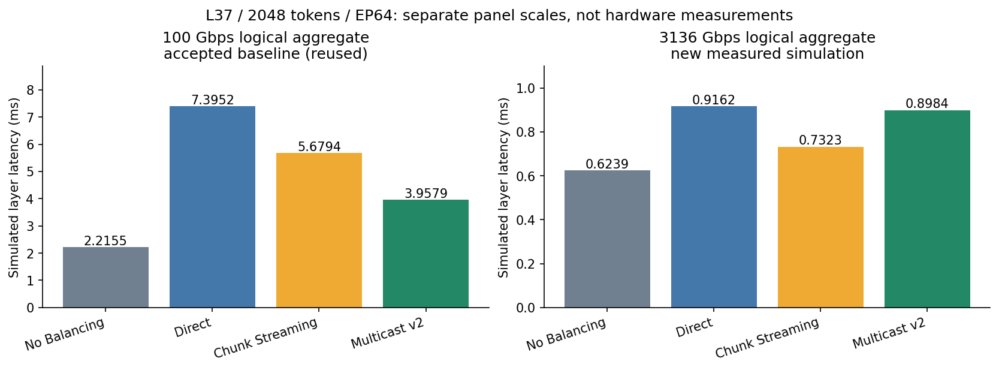
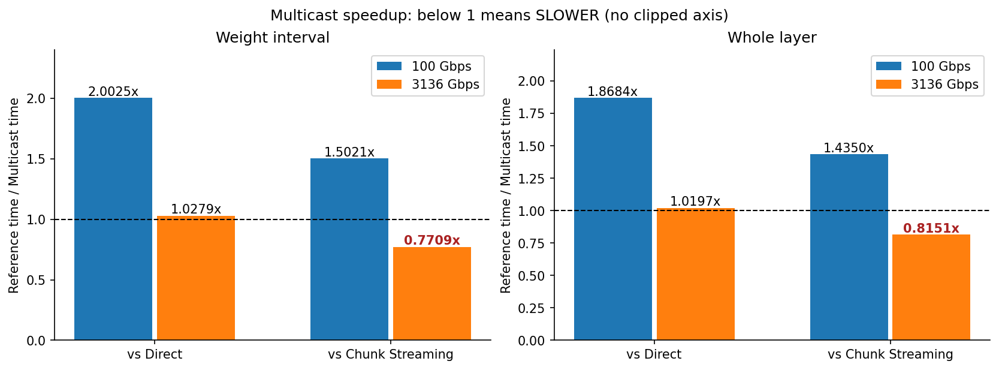
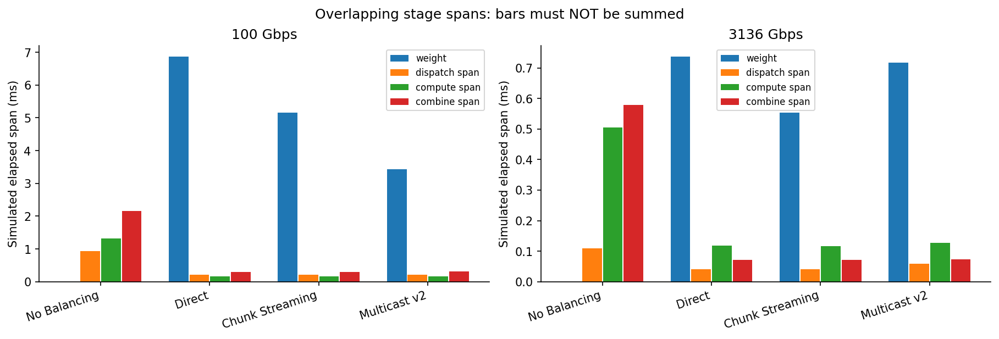

# CloudMatrix-inspired logical aggregate bandwidth: controlled Roofline comparison

## Result and scope

None of the three replication/balancing strategies beats No Balancing at 3136 Gbps in this measured workload.
No Balancing is 0.623937393 ms; Direct 0.916168696 ms; Chunk Streaming 0.732284971 ms; Multicast v2 0.898435170 ms.
Multicast versus Chunk changes from 1.4350× layer speedup at 100 Gbps to **0.8151× at 3136 Gbps**. The high-rate result is a reversal: Multicast is 22.69% longer than Chunk, not faster. It remains only 1.0197× faster than Direct.
The requested questions whether reduced replication cost makes balancing worthwhile and whether Multicast retains its advantage over Chunk are both answered negatively for this fixed workload. The pre-registered prediction of reduced communication durations is matched; a fully compute-dominated balanced layer is not observed. The completed matrix and strategy-order reversal are retained without tuning protocol, allocator or rate assumptions afterward.

For real Qwen3 L37 / 2048 tokens / EP64, the new 3136-Gbps simulation gives Multicast v2 **0.898435 ms** layer latency and **0.6945×** speedup against No Balancing. A ratio below one means slower, not an improvement.
The accepted 100-Gbps Multicast baseline is 3.957930 ms. Changing only the network rate gives 4.4054× layer speedup for this strategy, not a universal bandwidth scaling law.

| Rate (Gbps) | Multicast compared with | Weight speedup | Layer speedup | Weight saved (ms) | Layer saved (ms) |
|---:|---|---:|---:|---:|---:|
| 100 | Direct | 2.0025× | 1.8684× | 3.437895 | 3.437262 |
| 100 | Chunk Streaming | 1.5021× | 1.4350× | 1.721675 | 1.721519 |
| 3136 | Direct | 1.0279× | 1.0197× | 0.020023 | 0.017734 |
| 3136 | Chunk Streaming | 0.7709× | 0.8151× | -0.164289 | -0.166150 |

## How much does the bandwidth change reduce latency?

Each row compares the same strategy’s accepted 100-Gbps baseline with its new 3136-Gbps result. Speedup is old/new time; reduction is (old-new)/old. No Balancing has no replicated-weight interval at either rate, so its weight ratios are N/A rather than zero or infinity.
| Strategy | Weight: 100 → 3136 Gbps (ms) | Weight speedup | Weight reduction | Layer: 100 → 3136 Gbps (ms) | Layer speedup | Layer reduction |
|---|---:|---:|---:|---:|---:|---:|
| No Balancing | 0.000000 → 0.000000 | N/A | N/A | 2.215507 → 0.623937 | 3.5508× | 71.84% |
| Direct | 6.867180 → 0.737206 | 9.3151× | 89.26% | 7.395192 → 0.916169 | 8.0719× | 87.61% |
| Chunk Streaming | 5.150959 → 0.552894 | 9.3164× | 89.27% | 5.679449 → 0.732285 | 7.7558× | 87.11% |
| Multicast v2 | 3.429284 → 0.717183 | 4.7816× | 79.09% | 3.957930 → 0.898435 | 4.4054× | 77.30% |

## Is replication worthwhile? Exact observed accounting

None of the three replication/balancing strategies beats No Balancing at 3136 Gbps in this measured workload.
The non-overlapping timestamp identity is layer = planner + max(weight, reroute) + post-gate. Unlike the stage-span chart, these three adjacent intervals can be added. Relative to No Balancing, the added pre-gate interval must be smaller than the post-gate saving to obtain a net win. The saving is an observed composite interval, not an isolated compute improvement.
| 3136-Gbps strategy | Added pre-gate interval vs NoBal (ms) | Post-gate saving vs NoBal (ms) | Net extra layer time (ms) | Worthwhile here? |
|---|---:|---:|---:|---|
| Direct | 0.737405622 | 0.445174319 | 0.292231303 | no |
| Chunk Streaming | 0.553093591 | 0.444746013 | 0.108347578 | no |
| Multicast v2 | 0.717382855 | 0.442885078 | 0.274497777 | no |

Multicast minus Chunk at 3136 Gbps is exactly 166150.199 ns of extra layer latency: 164289.264 ns later weight readiness plus 1860.935 ns longer post-gate interval (equal 200 ns planner intervals). Thus 98.88% of the observed difference lies before the dispatch gate, in the weight interval. This is timestamp accounting, not proof that one source, allocator round or queue uniquely caused it.
Weight/layer share declines from 92.86% to 80.47% for Direct, from 90.69% to 75.50% for Chunk, and from 86.64% to 79.83% for Multicast. The remaining high-rate weight shares are still large, and all three dispatch gates are weight-ready constrained. The experiment has not become fully compute-dominated.
At 3136 Gbps the latest-ready experts are Direct 7;66, Chunk 73;100, and Multicast 7. These differ from accepted 100-Gbps Direct 66, Chunk 64, and Multicast 86; a change in the observed final readiness event is not a unique causal-path attribution.

## Hardware interpretation and fixed assumptions

This is a logical endpoint aggregate model, not a physical seven-link/fabric reconstruction or a hardware measurement. 3136 Gbps = 392 decimal GB/s is the nominal one-direction aggregate of a dual-die package: 2 × 7 × 224 Gbps. It is not 392 GB/s one-way per die, not bandwidth assigned to every physical link, and not verified single-peer throughput.
The versioned [CloudMatrix384 v2 source](https://arxiv.org/pdf/2506.12708v2) reports 196 GB/s one-way per die and a 135 GB/s inter-node WRITE measurement per die. Its peer count/concurrency and bandwidth-test message size are not established. [Version 3](https://arxiv.org/pdf/2506.12708v3) removes those numerical specifications; removal alone does not establish a correction. Full references and directionality are in [HARDWARE-REFERENCE.md](HARDWARE-REFERENCE.md).
The unchanged 20 ns propagation setting is not the paper’s 2.1 µs end-to-end inter-node WRITE latency or a protocol RTT. The existing 5 ns allocator interval, CBFC settings, transport behavior, packet/TA sizes, topology and queue settings are unchanged. Fixed allocator cadence and protocol/queue costs may limit high-rate scaling; this experiment neither removes them nor measures their unique causal contribution.
Compute remains the accepted Roofline-inspired max(compute, HBM) model: 100 TFLOP/s, 2692 decimal GB/s, zero launch charge. The 2692 value is the historical dual-die extrapolation from a v2 single-die MLA measurement, not measured expert-GEMM bandwidth. The model excludes calibrated small-batch efficiency, dequantization/scales and physical cross-die contention. See the accepted [MODEL.md](https://github.com/ponedo/ub-test/blob/3c2275eafea79426a441c819c8b65268492ff08e/experiments/qwen-roofline-compute/MODEL.md).

## Controlled comparison and baseline reuse

Only emitted runtime/parameter link_gbps and the corresponding input rate token change from 100 to 3136. Accepted Planner, assignment, routing, expert dimensions, native code, per-NPU serial scheduling, Weight Ready and compute formulas remain unchanged.
100-Gbps rows are reused accepted Roofline evidence at commit 3c2275eafea79426a441c819c8b65268492ff08e, not new full real runs. [source-provenance.json](results/source-provenance.json) records the accepted source audit. baseline-reuse.json proves regenerated baseline config/input/assignment hashes and semantic Planner hashes match all four accepted records. Current source and binary hashes are checked before collection. New binary paths/hashes remain in the private validation record; only identity count/digest is exported, and historical/new binaries are not claimed byte-identical.
Current Stage A requires 32 small cases (four fixtures × four strategies × two rates), 16 accepted-100 comparisons, native rate/rounding/credit-cell checks, ordinary UbPort/UbLink serialization of 40-byte credit and 160-byte data frames with 20 ns propagation, and three bounded native fault smokes. The ordinary-link probe checks busy gating, completion/receive timestamps and final idle state; it does not exercise upper-layer protocol processing. Published-baseline comparisons use only available accepted evidence; they do not imply a full historical event replay. All four new real cases must pass online payload, postflight, independent network and independent compute checks with no guard termination.
The unchanged Roofline model regression was rerun: 16 positive cases and six expected-negative cases pass; see results/model-unit/status.json. The formal four real runs retain the accepted no-loss default --nativeRetrans=false. Only the data-once and ack-once small fault smokes explicitly enable --nativeRetrans=1; the grant-invalidation smoke adds no new protocol. Disabling native retransmission in the no-loss formal runs does not disable CBFC or remove native ACK, transaction-response and WQE-completion checks. No retries or injected losses are recorded in the real Multicast lifecycle.
Native full-build success is not a claim that every native unit-test suite was executed. The reported scope is the model regression, bounded Stage A tests and four independently verified real cases.
Actual per-physical-expert token counts, FLOPs, HBM-byte estimates, duration and bottleneck classification are exactly equal between the two rates for each strategy. The common 16,384 expert-token invocations conserve top-k=8 × 2048; aggregate FLOPs are 6 × 2048 × 8 × 4096 × 1536. Different strategies can have different active-expert counts and weight HBM reads due to replicas; equality is checked between rates for each strategy, not incorrectly across all strategies.

## Simulated timings

| Gbps | Strategy | Planner ms | Reroute ms | Weight ms | Dispatch span ms | Compute span ms | Max-node compute ms | Combine span ms | Layer ms | Weight / layer | NoBal speedup |
|---:|---|---:|---:|---:|---:|---:|---:|---:|---:|---:|---:|
| 100 | No Balancing | 0.000000 | 0.000000 | 0.000000 | 0.928714 | 1.319327 | 0.437130 | 2.154647 | 2.215507 | 0.00% | 1.0000× |
| 100 | Direct | 0.000200 | 0.000100 | 6.867180 | 0.216323 | 0.160664 | 0.110032 | 0.301612 | 7.395192 | 92.86% | 0.2996× |
| 100 | Chunk Streaming | 0.000200 | 0.000100 | 5.150959 | 0.216488 | 0.156333 | 0.110032 | 0.298594 | 5.679449 | 90.69% | 0.3901× |
| 100 | Multicast v2 | 0.000200 | 0.000100 | 3.429284 | 0.216355 | 0.169447 | 0.110032 | 0.308012 | 3.957930 | 86.64% | 0.5598× |
| 3136 | No Balancing | 0.000000 | 0.000000 | 0.000000 | 0.109616 | 0.504390 | 0.437130 | 0.579721 | 0.623937 | 0.00% | 1.0000× |
| 3136 | Direct | 0.000200 | 0.000100 | 0.737206 | 0.041528 | 0.117697 | 0.110032 | 0.071731 | 0.916169 | 80.47% | 0.6810× |
| 3136 | Chunk Streaming | 0.000200 | 0.000100 | 0.552894 | 0.041743 | 0.115815 | 0.110032 | 0.072222 | 0.732285 | 75.50% | 0.8520× |
| 3136 | Multicast v2 | 0.000200 | 0.000100 | 0.717183 | 0.058860 | 0.126583 | 0.110032 | 0.074108 | 0.898435 | 79.83% | 0.6945× |

Stage spans are elapsed first-start to last-end windows and overlap. They are not additive stage costs; summing them double counts concurrent work. Weight/layer is a duration ratio, not a causal attribution of the whole layer.

## Observed gates and completion constraints

The exact source constraint is dispatch_gate = max(weights_end, reroute_end). The collector verifies that identity, identifies all latest-ready experts from expert-ready.csv, and verifies combine end equals layer end. Timestamps below are absolute simulated picoseconds, not durations. Empty latest-ready entries mean no remote weight readiness event.
| Gbps | Strategy | Latest-ready experts | Latest weight-ready ps | Dispatch gate ps | Gate constraint | Latest compute end ps | Combine end / layer end ps |
|---:|---|---|---:|---:|---|---:|---:|
| 100 | No Balancing | none | none | 1000 | weight_and_reroute_tie | 1365845444 | 2215508444 |
| 100 | Direct | 66 | 6867380560 | 6867380560 | weight_ready | 7186740807 | 7395193433 |
| 100 | Chunk Streaming | 64 | 5151160120 | 5151160120 | weight_ready | 5469685447 | 5679450313 |
| 100 | Multicast v2 | 86 | 3429485200 | 3429485200 | weight_ready | 3751862523 | 3957931193 |
| 3136 | No Balancing | none | none | 1000 | weight_and_reroute_tie | 534169802 | 623938393 |
| 3136 | Direct | 7;66 | 737406622 | 737406622 | weight_ready | 887105987 | 916169696 |
| 3136 | Chunk Streaming | 73;100 | 553094591 | 553094591 | weight_ready | 702607228 | 732285971 |
| 3136 | Multicast v2 | 7 | 717383855 | 717383855 | weight_ready | 875145070 | 898436170 |

At 3136 Gbps, Multicast’s post-gate interval is 0.181052 ms, versus No Balancing’s 0.623937 ms. Multicast’s layer end is 0.023291 ms after the latest NPU compute end. These intervals contain overlapping dispatch, compute, combine, serialization, credit and queue effects; they are not pure compute or protocol costs.
The latest-ready expert explains which observed weight-readiness event reaches the global gate, not a uniquely traced causal path to the final token. The latest compute-end timestamp likewise does not establish the final token’s unique critical path. A bandwidth-only comparison can show timings and constraints but cannot isolate allocator, CBFC, source injection or switch contention without additional controlled interventions. No such interventions were run.

## High-rate counterevidence and source-level hypotheses

Full counter and source-line details are in [HIGH-BANDWIDTH-ANALYSIS.md](HIGH-BANDWIDTH-ANALYSIS.md). The following findings constrain explanations of the Multicast/Chunk reversal; they do not establish a unique cause.

Measured Multicast coalescing is unchanged across rates: 368,640 envelopes, 36,864 native singleton packets, 415,236,096 source payload bytes and 498,401,280 source wire bytes. Neither loss of coalescing nor additional payload explains this reversal.
The recorded CBFC blocked counters are zero for both Chunk and Multicast; Multicast lifecycle reports zero native retries and zero injected losses. Maximum per-group association occupancy is 5 against per-group limit 1000. These counters do not support a credit-stall, retransmission/loss, or association-capacity-exhaustion explanation. Zero blocked counters are not a claim of zero queueing or zero feedback delay.
The largest recorded per-port VOQ peak is 567,628 B for Multicast versus 284,316 B for Chunk. The busiest switch output port records 162,945 total packets for Multicast versus 126,656 for Chunk. These are full-run per-port maxima, not weight-stage-local statistics; different ports’ peaks must not be summed as simultaneous occupancy. Total port packet counts include all recorded packet types, not solely ACKs/responses. The corresponding maxima for transport-ACK plus transaction-response packets alone are 159,072 and 122,640.
The final Multicast group has fanout 4; its first-send completion is 717330728 ps and the final expert Weight Ready is 717383855 ps, a 53.127 ns gap. This small final gap locates the observed ending relative to source completion; it does not attribute the preceding full interval to a single mechanism.
The unchanged source uses 5 ns allocation rounds, per-pair round-robin selection and all-member readiness for a multicast grant. ACK and transaction-response traffic is not coalesced. Together with the packet/queue counters, these make packet-service and feedback/readiness gating plausible explanations for non-ideal high-rate scaling. Without controlled interventions or a complete time-resolved causal trace, neither the allocator alone nor feedback alone is established as the unique cause.
The model also retains InportProcessingDelay=0 and packet-rate-control=NONE. Switch parse/rebuild processing costs are not hardware-calibrated. These omissions limit physical-hardware conclusions even though the current native simulation passes its correctness checks.

## Host resource evidence

| Strategy | Start UTC | End UTC | Wall seconds | CPU seconds | Peak RSS GiB | Concurrent simulator overlap |
|---|---|---|---:|---:|---:|---|
| No Balancing | 2026-10-21T02:28:51.278003+00:00 | 2026-10-21T02:30:01.484473+00:00 | 70.206 | 69.950 | 0.757 | direct:69.218s |
| Direct | 2026-10-21T02:28:52.266582+00:00 | 2026-10-21T02:35:10.394407+00:00 | 378.128 | 377.848 | 3.669 | no-balancing:69.218s;chunk-streaming:306.884s |
| Chunk Streaming | 2026-10-21T02:30:03.510044+00:00 | 2026-10-21T02:41:31.775897+00:00 | 688.266 | 688.028 | 3.559 | direct:306.884s;multicast-v2:377.049s |
| Multicast v2 | 2026-10-21T02:35:14.726475+00:00 | 2026-10-21T02:43:19.166833+00:00 | 484.440 | 484.119 | 3.674 | chunk-streaming:377.049s |

Minimum sampled host available memory: 1.334 GiB across 870 coordinator samples. This is system-wide, includes unrelated activity and is not a proof about unobserved intervals. resources.csv records per-strategy start/end and simulator overlap; detailed admission events remain private; build-receipts.json retains 7 bounded build receipts, including any failures and resumptions.
At most two independent case workers; admission uses measured availability, historical peak × 1.05, remaining peak growth, 128 MiB extra margin, 1 GiB available-memory reserve and CPU/load checks. Each case retains 6 GiB tree-RSS, 7 GiB address-space, 4800-second whole-case wall, 8 GiB work-disk/2 GiB tmp free-space limits, an 8 GiB logical payload budget and one-million weight-task limit. Sandboxed process visibility is incomplete. Concurrent host wall/CPU timings are resource evidence, not strict strategy-performance rankings.

## Privacy, limitations and reproduction

Publication is aggregate-only: strategy timings, work/communication/correctness totals, queue maxima without node identifiers, fanout histogram, compact synthetic-test summaries and required per-strategy resource scalars. The explicitly requested last Weight Ready Expert IDs and timestamps are the only retained real expert identifiers. correctness-aggregate.csv reports drained PSN/TA windows, zero outstanding state and total credit conservation, with explicit confirmation that the full private per-port credit and transport-window checks passed. All detailed per-node/per-expert/per-packet tables, online summaries, host receipts/admission events, absolute-path source/binary maps, real inputs and raw traces remain private. Pending batched-credit totals may be nonzero: the checked conservation includes these credits; this is not unacknowledged payload or a claim that every credit counter resets to its initial value.
One fixed real layer/token-count point is not a scaling survey. The verified payload is deterministic validation data, not real checkpoint numerical inference. Simulation speedups must not be presented as measured Ascend performance or physical CloudMatrix topology performance.
See [README.md](README.md) and reproduce.sh. The script reconstructs no new protocol, runs no old full real Roofline matrix, and refuses non-fresh output. PNG and SVG plots are generated only after strict collection passes.
