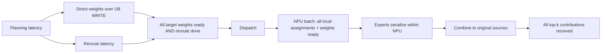

# Phase 1: Direct expert weights + MoE prefill Forward

Base: `a9ba52f6fdd2b7b5ef26913032aad2d11ab852ac`. Reuses the accepted `upstream-compatible` Planner at fixed UltraEP `94cab099b44fffa99a82fea99e7c12d89cf65e4f`. Implements only single-layer Direct replication and Forward. The old Planner, NoBalancing executor and three-node Chunk Relay PoC are unchanged.

## Run and artifacts

```bash
bash experiments/direct-weight-forward/run.sh
```

Requires the existing pinned ns3 checkout at `/workspace/ns-3-ub` (d6aa9e242d5a93f5bbd1ad54f39b1620c1b8757b), tools submodule 29009175f1778f76a22d929063c3a0821cb91e56, C++20, Python 3.12 and `/workspace/build-tools`. `NS3_ROOT`, `BUILD_TOOLS`, `EVIDENCE` and `BUILD_JOBS` can override paths/jobs. The script builds the new scratch executable, runs the frozen 26-row matrix, ordinary/optimized checks and all accepted regressions. Old Planner tests run in an isolated archive so their evidence is not overwritten. New evidence is deterministic apart from CPU wall time/ledger timestamps.

Use `build.sh` for a targeted build, `suite.py --ns3 PATH --out PATH` for the declared matrix, `tests.py` for negative/coverage checks and `verify.py CASE_DIR` for independent event reconstruction. `cases.py` defines and materializes the package specs; `matrix.yaml` and `command-manifest.yaml` freeze the planned rows and command templates. `run-ledger.json` records actual commands, return codes, timestamps and per-case summaries.

Every case contains `config.json`, the original `plan.json` (including Planner raw reference/repair evidence), executable `input.txt`, assignment/transfer tables, `events.csv`, stdout, independently checked summaries and native task/packet/port/AllPacketTrace logs. Raw weights/activations are real explicit ns3 Packet payloads; each received byte is checked in C++ before the corresponding verification event. Network regression raw-trace hashes and summaries are retained under `evidence/prior-regression/`.

## Scheduling evidence and implementation

[UltraEP v3 §4.2, Figure 8](https://arxiv.org/html/2606.04101v3#S4.SS2) permits weight distribution to overlap reroute and requires dispatch to wait for weight synchronization. The [pinned README forward sequence](https://github.com/Dots-Infra/UltraEP/blob/94cab099b44fffa99a82fea99e7c12d89cf65e4f/README.md#L134-L148) explicitly orders planning, asynchronous weight_sync, reroute, weight-event wait, dispatch, experts, and combine. The [fixed Manager::weight_sync implementation](https://github.com/Dots-Infra/UltraEP/blob/94cab099b44fffa99a82fea99e7c12d89cf65e4f/csrc/ultra_ep.cpp#L1095) waits on prior work and exposes a communication completion event or compute-stream wait. We implement that dependency with a single ns3 Simulator clock; GPU stream/kernel execution itself is not simulated.



Layer time begins after logical routing information is available; gating and notify-dispatch collection are outside both compared modes. Planner output may be precomputed, but `planning_ns` and `reroute_ns` are charged as explicit simulated time. CPU planner wall time never enters the simulated clock. Required TPs and task objects are prepared before layer start in both modes; connection creation/control-plane overhead is not separately timed.

Planning completes before Direct sends/reroute begin. Each replica has one whole-weight WRITE WQE from its fixed main. Its target transaction validates source, destination, opcode, physical/main/logical identities and every byte. A ChunkTracker aggregates **target execution completions**, after the transaction's completion callback, across all TA offsets. Sender WQE completion is recorded for diagnostics and is never a ready dependency. The canary proves dispatch can precede the later sender completion. All main weights are resident at layer start.

The global dispatch gate waits for all replicas and reroute. Each NPU then waits for all of its assigned tokens and required physical weights before computing its batch; nonempty experts run sequentially on that NPU, independent NPU batches can overlap. Combine starts after the NPU batch finishes; a source token finishes only after all original top-k contributions return. Dispatch and Combine use the exact same rule in both policies: one remote WQE per assignment per direction; local assignments take the same verified local path with no network WQE. No packing is present.

## Adapter and extension contract

`adapter.py` preserves logical expert, physical ID, target rank, source, token index and top-k index. It invokes the accepted Planner checker, reconstructs physical assignment counts and validates weight provenance before emitting execution input. NoBalancing uses fixed mains and the identical routing trace. The C++ reader independently checks identities, quotas and provenance. `verify.py` reconstructs every transfer, TA coverage, ready event, compute interval and token completion from raw events.

`weight-distribution.h` defines a strategy interface returning edges with source/target physical IDs, byte range and source dependency scope (`FullExpert` or `Chunk`). Direct emits one full-range main-to-replica edge. `TwoStageRelay` and `ChunkStreamingRelay` are reserved enum values; both Python and C++ reject them. Future executors must implement forwarding and the declared source-readiness dependencies; they must not alias these modes to Direct. This milestone does not extend the old relay PoC or implement a multi-NPU relay.

The input file has: (1) the 14 legacy model/network fields listed in `adapter.KEYS`; (2) matrices, weight bytes, planning ns, reroute ns, target weight completion ns, balanced flag, strategy ID, physical count; (3) fixed main placement; (4) physical rows `id expert rank is_replica quota main_id main_rank`; (5) token rows `source (logical physical)*top_k`. Task IDs are dispatch 0..A-1, combine A..2A-1, followed by one weight task per replica in physical-ID order. Event task IDs join directly to `transfers.csv`.

## Parameters, FLOPs and limits

All values in this matrix are **synthetic assumptions**, not public hardware specifications or fitted measurements. The model is a scaled SwiGLU MoE, not a named production model. Default H=64, I=128, dtype=2 bytes, three matrices, peak=1000 GFLOP/s, utilization=0.5, per-expert setup=100 ns. Three dense matrix multiplies cost **6 H I FLOPs per assignment** and store **3 H I dtype bytes per expert** (49,152 here). `matrices=2` retains the old 4HI/two-matrix functional model; both members of every pair use the same formula. The legacy cross-executor check reproduces identical two-matrix latency and NPU loads.

Per-expert duration in ps is `ceil(assignments * 2*matrices*H*I * 1e6 / (peak_gflops*util_permille)) + setup_ns*1000`. This models GEMM-equivalent work at fixed effective throughput; elementwise SwiGLU, gating, numerical MLP execution, memory-bandwidth limits and size-dependent kernel efficiency are excluded. Compute result bytes are a deterministic synthetic transform, not neural inference results. Therefore this validates execution and parameterized simulation, not real NPU acceleration.

Default planning=200 ns and reroute=100 ns in UltraEP; NoBalancing bypasses both. Single-switch links are 100 Gb/s with 20 ns propagation; TA segment is 1024 bytes. Target weight execution delay defaults to zero; a dedicated 2000 ns case tests completion ordering. Another case makes reroute last 100000 ns to verify overlap in the other direction. Nondivisible H=65/I=129/segment=333 tests final partial TAs. Full resolved per-case parameters, runtime overrides and queried native attribute/global catalogs accompany the evidence. CC is disabled identically to the accepted baseline; other native defaults are pinned by simulator commit/catalog. Default weight size is exactly the configured matrices; optional byte overrides are labeled `synthetic_override` and cannot support a full-weight production claim.

The public planner's dynamic floor can create replicas below configured minimum 1024; this is accepted upstream behavior, unchanged here. Single EP domain and contiguous equal main placement/uniform slots are required by that planner. Executor bounds are N<=72, E<=512, at most 100000 assignments, <=64 MiB per replica and <=256 MiB total explicit transfer buffers. Payload-size violations fail before simulation. No decode/training/backward, multi-layer, EPLB, TTFT/TPOT/SLO or Phase 2 sweep is implemented.

See [REPORT.md](REPORT.md) for all positive/negative observations and the measured layer-latency ratios.
