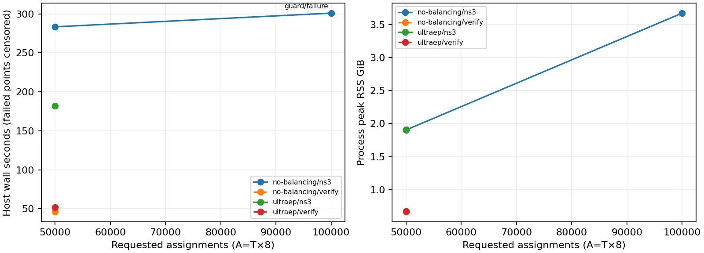

# EP64 prefill capacity observations

This is an actual bounded host-capacity experiment, not a speedup scan. Topology, synthetic routing distribution, application/native semantics and model parameters are fixed in [experiment-plan.md](../experiment-plan.md). Host resource guards were declared before execution.

Measured starting host: cgroup memory limit 17179869184 bytes; CPU quota/period 400000 100000 microseconds; workspace free 28.03 GiB. Process-tree RSS guard 8GiB, cgroup guard 12GiB, ns3/verifier wall guard 300 seconds each. No swap was available. ns3 wall covers the whole executor process, including input/topology creation and payload/log flush, not just the event kernel.

## Result and scope

Largest fully verified requested NoBalance scale: **50,000 assignments**. Simulation completion alone is not counted as success. No OOM claim follows from a timeout or software rejection.

| Mode | Requested T / A | Status | ns3 wall s | ns3 peak RSS GiB | Verifier wall s | Verifier peak RSS GiB | Simulated layer µs |
|---|---:|---|---:|---:|---:|---:|---:|
| no-balancing | 6,250 / 50,000 | success | 283.40 | 1.904 | 46.15 | 0.665 | 1,353.604768 |
| no-balancing | 12,500 / 100,000 | failed | 300.96 | 3.672 | — | — | — |
| no-balancing | 25,000 / 200,000 | not_attempted | — | — | — | — | — |
| no-balancing | 62,500 / 500,000 | not_attempted | — | — | — | — | — |
| no-balancing | 125,000 / 1,000,000 | not_attempted | — | — | — | — | — |
| ultraep | 6,250 / 50,000 | success | 182.12 | 1.907 | 51.69 | 0.673 | 151.659632 |
| ultraep | 12,500 / 100,000 | not_selected | — | — | — | — | — |
| ultraep | 25,000 / 200,000 | not_selected | — | — | — | — | — |
| ultraep | 62,500 / 500,000 | not_selected | — | — | — | — | — |
| ultraep | 125,000 / 1,000,000 | not_attempted | — | — | — | — | — |

The CSV additionally records generation/plan/adapter CPU and wall time/RSS, sampled process-tree RSS, generated tasks/WQEs, expected and observed request TAs, application log rows, actual ns3 event count, raw log sizes and partial-token completion. Missing metrics are unavailable, never zero-filled as successful results. Each stage console/resource trace and raw artifact hashes are in `runs/<case>/`. Complete synthetic raw evidence is losslessly archived per attempted case.

## Failures, unattempted and unselected cases

- **no-balancing-100000 — failed**: wall_guard
- **no-balancing-200000 — not_attempted**: Sequential expansion stopped after no-balancing-100000 ns3: wall_guard
- **no-balancing-500000 — not_attempted**: Sequential expansion stopped after no-balancing-100000 ns3: wall_guard
- **no-balancing-1000000 — not_attempted**: 20-bit wire Jetty ID preflight rejects approximately 2M global task IDs; original T cap also exceeded; no remapping or protocol change authorized
- **ultraep-100000 — not_selected**: Representative treatment rule selects first/largest fully verified NoBalance scale only; no full strategy matrix
- **ultraep-200000 — not_selected**: Representative treatment rule selects first/largest fully verified NoBalance scale only; no full strategy matrix
- **ultraep-500000 — not_selected**: Representative treatment rule selects first/largest fully verified NoBalance scale only; no full strategy matrix
- **ultraep-1000000 — not_attempted**: 20-bit wire Jetty ID preflight rejects approximately 2M global task IDs; original T cap also exceeded; no remapping or protocol change authorized

## Phase cost and traffic counts

| Case | Plan wall s | Plan CPU user+sys s | Adapter wall s | Remote WQEs planned | Request TAs observed | ns3 events executed | Application rows | Native logs MiB |
|---|---:|---:|---:|---:|---:|---:|---:|---:|
| no-balancing-50000 | 0.50 | 0.066 | 2.51 | 98,386 | 98,386 | 4,487,239 | 798,701 | 359.34 |
| no-balancing-100000 | 0.50 | 0.098 | 5.02 | 196,794 | 57,324 | — | 534,663 | 208.73 |
| ultraep-50000 | 0.50 | 0.560 | 3.01 | 94,819 | 97,276 | 4,266,877 | 794,912 | 359.75 |

NoBalance plan time is baseline plan construction/serialization, **not invocation of the CPU quota solver**. UltraEP plan time includes the actual CPU solver/checker and serialization (including reference preparation/compilation if its cache is cold); the adapter reuses that exact saved plan instead of solving again. Configured planning/reroute nanoseconds are the only planner delays in simulated time. Wall measurement includes 0.5-second exit-poll granularity; user/system CPU times use wait4. Peak RSS is wait4 ru_maxrss; sampled tree RSS sums process RSS and may double-count shared pages. Cgroup memory includes other resident/cache memory. These metrics are deliberately not conflated.

Transaction count here means **target-received request TAs**, not the count of transaction-engine objects (one per host), and not ACK responses. Generated remote WQEs are case-derived; completed WQEs/TAs and application events are trace-derived. `Simulator::GetEventCount()` is emitted only when `Simulator::Run()` returns. A guard-killed process therefore has no complete ns3 event count even when a partial application CSV exists.

## Resource curves

No extrapolated points or speedup curves are shown. Failed/timed-out ns3 points are censored at the protection boundary, not completed runtimes. The per-stage `resource-samples.csv` files retain the complete measured RSS/cgroup/time trajectories.

## Capacity interpretation and next work

- The old 100K-assignment/256MiB guards are software constraints. This experiment distinguishes those from observed host-wall/resource stops. See [native/integer/allocation audit](../SAFETY-AUDIT.md).
- Per-remote-Jetty ACK windows alone require 16KiB each; explicit payload, per-task metadata, packet/events, Python JSON and verifier copies add further cost. No window resizing, pooling, packing, logical payload, protocol edits or verifier optimization was performed.
- 20-bit wire Jetty IDs prohibit the requested 1M assignment case under the current global-task-ID mapping. This is separately confirmed by a cheap preflight rejection. 500K can fit the conservative wire namespace but that is not a host-memory feasibility result.
- T=125000 at 1M also exceeds the old T cap. Raising T/A caps alone cannot repair the wire-ID issue. The persistent weight-buffer term absent from the old byte check is documented; the tested scaled cases remain under the unchanged byte admission.
- For the next EP64 correctness experiment, start at or below the observed T=6250/A=50000 point with the same H64/I128/bf16/top-k8 assumptions and guards. This is an engineering starting envelope, not proof that every smaller/differently skewed input succeeds. T=12500/A=100000 did not complete within the declared 300-second ns3 budget.
- The feasible range on this host is limited to fully verified observed scales and this fixed synthetic workload. Unattempted 200K/500K points cannot be called OOM, feasible, or successful; different skew/locality/model bytes can change costs.
- Native lifecycle-ID allocation scans registered Jetty records per submission (`ub-function.cc:697-718`), creating a plausible quadratic host-cost path. No profiler-based percentage attribution or protocol throughput inference is claimed.
- Future work should first investigate the measured slow phase using profiler evidence, then separately approve any event/task/Jetty or verifier indexing changes. No optimization proposal is implemented in this study.

## Regressions and parity

Small NoBalance and ChunkStreaming runs before/after instrumentation compare all emitted application/native/payload files byte-for-byte, excluding only the new optional metrics JSON. `parity-instrumented.json` records hashes. Full accepted Relay→Direct→Planner/NoBalance/PoC regression results are retained in `regressions/` and `regression-resource.json`. Default executor output and all submission/TA/chunk/group dependency behavior remain unchanged.

Knowledge sources: repo-local OpenUSim plan/run/analyze skills, controlled-experiment-method, trace-observability and transport-channel cards; pinned native headers and application verifier source. The bespoke accepted application creates its own topology/TPs rather than using UbApp traffic generation.
