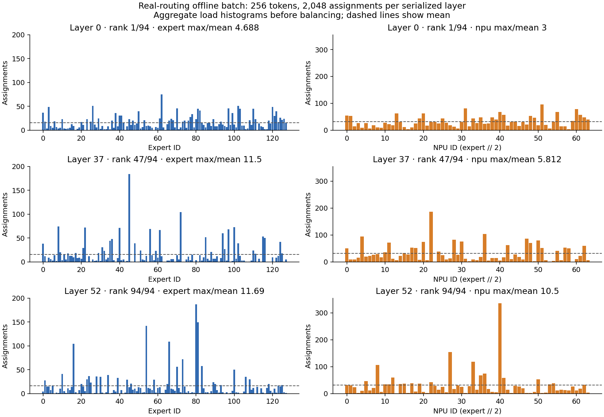
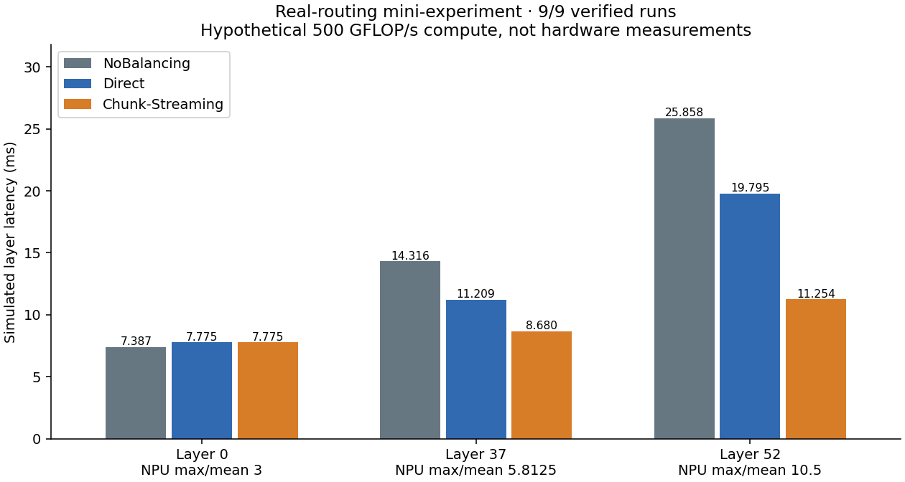
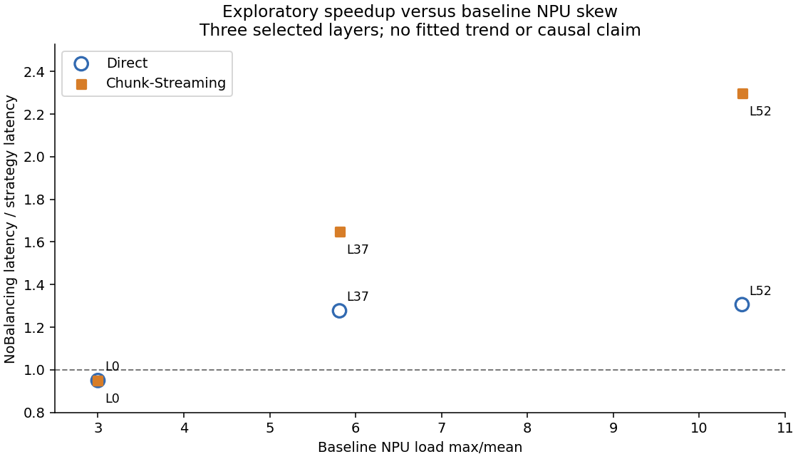

# Real-routing Qwen3-235B-A22B mini-experiment

Current aggregate export: 9/9 runs verified PASS. Only completed runs have numeric results; pending or stopped runs are not imputed.

## Scope and fixed assumptions

This is a discrete-event simulation driven by observed routing, not a numerical Qwen inference or hardware measurement. The fixed offline batch takes 22 + 224 + 10 tokens from three independent requests in existing manifest order. It is not an observed joint-forward batch. The same 256 tokens and 2,048 top-8 assignments are used in each selected serialized layer. Serialized layer IDs and source token ordinals have not independently been proven to be model-layer IDs or tokenizer IDs.

All 94 layers are ranked ascending by baseline NPU max/mean, breaking ties by serialized layer ID. Ranks 1, 47 (lower median), and 94 select layers 0, 37, and 52. Main placement is expert // 2 on 64 NPUs with 128 experts; source NPU is offline-batch token ordinal % 64. Source placement is an experimental assumption.

Official model dimensions are H=4096, routed-expert I=1536, top-k=8. Ideal FP8 expert weights are 3HI = 18,874,368 bytes (18 MiB). The model requires another 4,608 bytes of FP32 block scales per expert, omitted here along with runtime padding/repacking. This is not the exact checkpoint/runtime footprint. Dispatch and combine use BF16 vectors (8,192 bytes per assignment per direction); BF16 wire precision is an assumption separate from dynamic FP8 compute-input quantization.

Compute counts three GEMMs at 6HI = 37,748,736 FLOPs per assignment with hypothetical effective 500 GFLOP/s, plus unchanged 100 ns per nonempty physical expert. Planning 200 ns and reroute 100 ns settings remain unchanged. Network configuration is 100 Gbps per UbPort, 20 ns per UbLink delay, TA 1,024 bytes, chunk 4,096 bytes and pair jetty mode.

## Baseline aggregate skew

| Serialized layer | Rank / 94 | Expert max/mean | Expert Gini | Expert Jain | NPU max/mean | NPU Gini | NPU Jain |
|---|---|---|---|---|---|---|---|
| 0 | 1 | 4.6875 | 0.4582 | 0.5666 | 3.0000 | 0.3527 | 0.7077 |
| 37 | 47 | 11.5000 | 0.6582 | 0.2888 | 5.8125 | 0.5129 | 0.4833 |
| 52 | 94 | 11.6875 | 0.6752 | 0.2391 | 10.5000 | 0.5580 | 0.3114 |

Gini includes inactive experts/NPUs (zero load). Jain = (sum loads)² / (entity count × sum squared loads), also including zero-load entities. Higher Gini and lower Jain indicate more imbalance. The all-layer CSV contains all 94 layers, not only the selected examples.

## Verified results

| Layer | Strategy | Layer latency ms | Speedup vs NoBalancing | Weight WQEs | Max NPU load | Simulator host wall s |
|---|---|---|---|---|---|---|
| 0 | NoBalancing | 7.387077 | 1.0000× | 0 | 96 | 4.765 |
| 0 | Direct | 7.774681 | 0.9501× | 39 | 34 | 178.496 |
| 0 | Chunk-Streaming | 7.775047 | 0.9501× | 39 | 34 | 173.488 |
| 37 | NoBalancing | 14.315546 | 1.0000× | 0 | 186 | 4.766 |
| 37 | Direct | 11.209255 | 1.2771× | 44 | 34 | 196.831 |
| 37 | Chunk-Streaming | 8.679992 | 1.6493× | 23079 | 34 | 305.874 |
| 52 | NoBalancing | 25.857943 | 1.0000× | 0 | 336 | 4.265 |
| 52 | Direct | 19.795015 | 1.3063× | 43 | 34 | 202.586 |
| 52 | Chunk-Streaming | 11.254239 | 2.2976× | 106004 | 34 | 865.922 |

Layer latency is simulated critical-path elapsed time. Host wall time is the time needed to execute the simulator on the host and is not model inference latency. Dispatch, compute and combine spans can overlap and must not be summed as disjoint stage times. The maximum per-NPU compute interval is distinct from the global compute span.

The unchanged original Chunk-Streaming algorithm produces the same 39 weight WQEs as Direct on low-skew layer 0 because its relay threshold is not reached. This is a threshold-driven outcome, not a replacement of Chunk-Streaming with Direct.

## Interpretation limits

The speedup-versus-skew figure is descriptive for three deliberately selected layers only. Layer-specific expert placement, traffic, replication, and critical paths also differ. These observations cannot establish a causal or universal relationship between a single skew statistic and speedup. There are no replicate-run confidence intervals. Neither the plotted latencies nor their speedups establish physical-NPU performance. Historical 30B Zipf results (including the previously reported 8.31×) are background only, not a controlled real-routing-versus-Zipf A/B: this run also changes model size, H/I, ideal FP8 weight payload (18 MiB versus historical BF16 9 MiB) and GEMM FLOPs (4×). A speedup difference across those experiments cannot be attributed solely to routing. The controlled comparison here is among the three strategies within each selected layer.

The figures and CSV expose only aggregated expert/NPU counts and scalar run metrics, never per-token routing.

## Official precision references

- [Pinned official config](https://huggingface.co/Qwen/Qwen3-235B-A22B-FP8/resolve/39eb2b067ea6b8e3e1dd97d3cd0c7ffeaf3e1a35/config.json)
- [Qwen3-MoE implementation, Transformers v4.51.0](https://github.com/huggingface/transformers/blob/v4.51.0/src/transformers/models/qwen3_moe/modeling_qwen3_moe.py#L223-L252)
- [FP8 implementation and scale format](https://github.com/huggingface/transformers/blob/v4.51.0/src/transformers/integrations/finegrained_fp8.py#L294-L353)

See model-precision.md for the full precision audit and fixed-cost source verification.

## Observed comparisons (completed cases only)

- Layer 0, Direct: latency 5.25% higher than NoBalancing; max NPU assignments 96 → 34; weight-target duration 5.150905 ms. This duration is a separate measured interval, not an additive phase decomposition.
- Layer 0, Chunk-Streaming: latency 5.25% higher than NoBalancing; max NPU assignments 96 → 34; weight-target duration 5.151270 ms. This duration is a separate measured interval, not an additive phase decomposition.
- Layer 37, Direct: latency 21.70% lower than NoBalancing; max NPU assignments 186 → 34; weight-target duration 8.585718 ms. This duration is a separate measured interval, not an additive phase decomposition.
- Layer 37, Chunk-Streaming: latency 39.37% lower than NoBalancing; max NPU assignments 186 → 34; weight-target duration 6.056032 ms. This duration is a separate measured interval, not an additive phase decomposition.
- Layer 52, Direct: latency 23.45% lower than NoBalancing; max NPU assignments 336 → 34; weight-target duration 17.171329 ms. This duration is a separate measured interval, not an additive phase decomposition.
- Layer 52, Chunk-Streaming: latency 56.48% lower than NoBalancing; max NPU assignments 336 → 34; weight-target duration 8.630465 ms. This duration is a separate measured interval, not an additive phase decomposition.
- Layer 0, Chunk-Streaming minus Direct latency: 0.36556 µs. The [aggregate graph audit](results/low-layer-strategy-order.json) finds identical full edge-field multisets (39 scope=0 edges) but all 39 sequence positions differ: Direct uses physical-list order while Chunk uses ordinal physical order. The small latency difference is consistent with these existing submission-order differences; no causal intervention scan was performed.

## Validation and resource protection

All 36 recorded preparation, preflight, simulator and postflight stages have status PASS with no triggered guard.
The [finalized archive audit](results/finalized-archive-audit.json) has 9/9 cases PASS; overall status PASS. It verifies archived source/top-k positions, assigned and completed token counts, sender/target completion counts, hashes, and Direct/Chunk planner equality excluding host cpu_wall_ns. These checks validate simulator execution against its inputs, not physical hardware fidelity.

Stage resource records: [resources.json](results/resources.json). Scalar simulator results: [performance.csv](results/performance.csv).

Maximum recorded peak RSS across the 36 experiment stages: 2,771,260 KiB (2.643 GiB), layer 37 direct Simulator. This is measured host memory consumption, not simulated NPU memory.

## Regression coverage

- 3 precision unit tests and [56 independent reproducible integration checks](results/qwen-real-reproducible-review.json) passed.
- [4 legacy input-byte regression cases](results/input-regression.json) passed.
- [5 actual small/EP64 simulator regression cases](results/runtime-regression.json) passed with summary-output equality excluding verification_wall_ns.
- [13 actual fault-injection cases and 1 actual Qwen30B Zipf NoBalancing 256-token regression](results/final-runtime-compatibility.json) passed: faults were rejected with nonzero exits and FAIL validation; the Zipf run outputs matched the baseline except verification_wall_ns.
- [5 incomplete/duplicate final-inventory rejection checks](results/final-inventory-tests.txt) passed.

## Figures

## Possible next step (not started)

A separately authorized next experiment could expand the selected-layer sample and hold model dimensions, precision and routing inputs fixed when testing other variables. No additional stage or scan is launched by this analysis.
