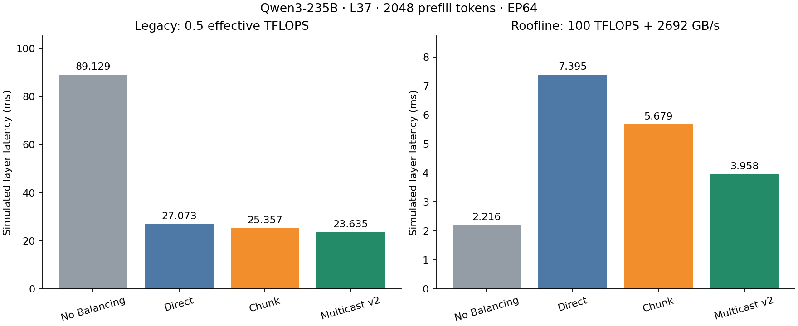
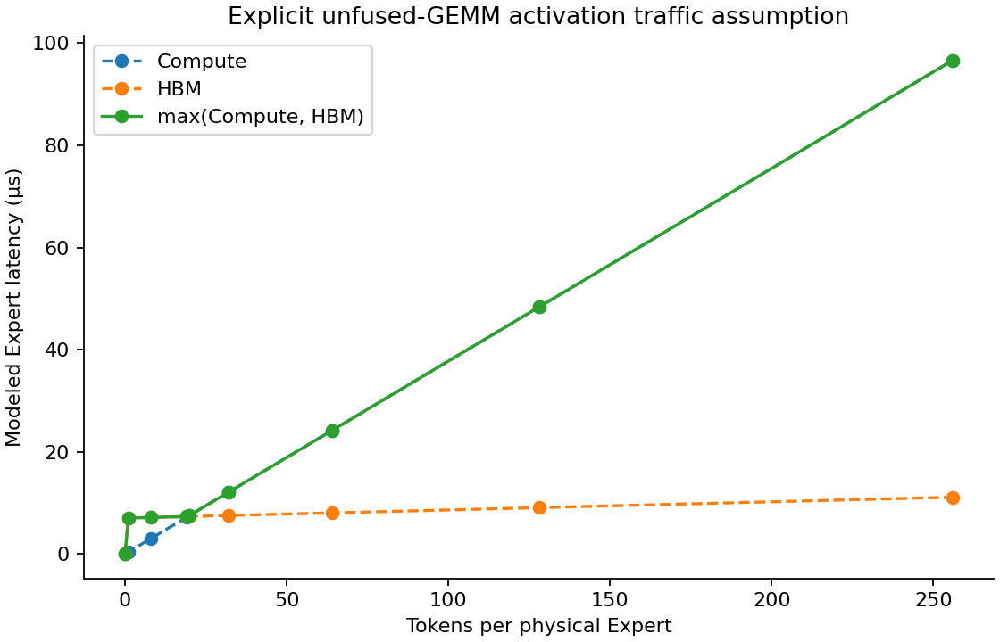

# UltraEP Expert Compute Roofline 与真实 Qwen3 Prefill 复测

## 结论

L37 / 2048 Token / EP64：Roofline 下 Multicast 对 Chunk 的权重分发加速 **1.5021×**，整层加速 **1.4350×**；旧 Legacy 对应 1.0729× 整层加速。
Roofline 下 Multicast 相对 No Balancing 的整层加速比为 **0.5598×**（小于1表示更慢）。这是单场景、假设参数下的仿真结论，不是昇腾硬件实测。

两面板使用不同纵轴刻度，数值单位均为模拟ms。

## 模型与公平性

仅替换每个非空 Expert invocation 的 Duration。Planner、Placement、Token Routing、Weight Ready、逐 NPU 物理 Expert 顺序串行调度、UB 协议与 Dispatch/Combine 代码不变。全部真实策略使用相同 Trace 和参数；三种 UltraEP 策略使用相同 Planner/assignment hashes。原生109个源文件与已验收集成一致，运行前锁定所有使用的非test ns3动态库及executor哈希。

- Legacy：保留原500 GFLOP/s有效计算吞吐和100ns setup，精确取整；16个小场景与原父版本逐字段一致（仅剔除宿主验证计时）。旧真实结果标明来源ef1ec5c，不冒充本轮重跑。
- Roofline：有效100 TFLOPS/NPU、2692十进制GB/s/NPU、launch=0；T=max(compute,memory)，不再乘旧util。
- 权重已在HBM中，非空Expert每次完整读取一次；FP8三矩阵为18,874,368B。不按每token重复整份读取，不与UB网络复制合并。
- BF16激活采用三独立GEMM、融合SiLU/mul、无跨GEMM缓存：输入2mH、中间6mI、输出mH个元素，共43,008m B。m=0无事件、无HBM开销。
- 硬件出处固定为[CloudMatrix384 v2表9/p48](https://arxiv.org/pdf/2506.12708v2#page=48)：单die MLA achieved bandwidth1346GB/s。2692为双die相加的参考估算；100TFLOPS为假设，均不是小batch Expert GEMM测量。v3移除了该绝对带宽数值。完整口径及限制见[MODEL.md](MODEL.md)。

## 模型单元测试

| Tokens | FLOPs | HBM bytes | Compute (µs) | Memory (µs) | Roofline (µs) |
|---:|---:|---:|---:|---:|---:|
| 0 | 0 | 0 | 0.000000 | 0.000000 | 0.000000 |
| 1 | 37,748,736 | 18,917,376 | 0.377488 | 7.027258 | 7.027258 |
| 8 | 301,989,888 | 19,218,432 | 3.019899 | 7.139091 | 7.139091 |
| 19 | 717,225,984 | 19,691,520 | 7.172260 | 7.314830 | 7.314830 |
| 20 | 754,974,720 | 19,734,528 | 7.549748 | 7.330806 | 7.549748 |
| 32 | 1,207,959,552 | 20,250,624 | 12.079596 | 7.522521 | 12.079596 |
| 64 | 2,415,919,104 | 21,626,880 | 24.159192 | 8.033760 | 24.159192 |
| 128 | 4,831,838,208 | 24,379,392 | 48.318383 | 9.056238 | 48.318383 |
| 256 | 9,663,676,416 | 29,884,416 | 96.636765 | 11.101195 | 96.636765 |

本口径中整数token数≤19为memory-bound，≥20为compute-bound。这个转折来自给定参数和HBM假设，不是硬件标定。

## 新旧四策略（模拟时间，ms）

| Model | Strategy | Weight | Dispatch span | Compute span | Max NPU compute | Combine span | Layer | vs NoBal |
|---|---|---:|---:|---:|---:|---:|---:|---:|
| legacy | No Balancing | 0.000000 | 0.854802 | 88.234557 | 87.426273 | 88.092733 | 89.129315 | 1.0000× |
| legacy | Direct | 6.867180 | 0.216323 | 19.838164 | 19.780738 | 8.193729 | 27.073308 | 3.2921× |
| legacy | Chunk Streaming | 5.150959 | 0.216488 | 19.834833 | 19.780738 | 8.190549 | 25.357403 | 3.5149× |
| legacy | Multicast v2 | 3.429284 | 0.216355 | 19.843963 | 19.780738 | 8.199161 | 23.635079 | 3.7711× |
| roofline | No Balancing | 0.000000 | 0.928714 | 1.319327 | 0.437130 | 2.154647 | 2.215507 | 1.0000× |
| roofline | Direct | 6.867180 | 0.216323 | 0.160664 | 0.110032 | 0.301612 | 7.395192 | 0.2996× |
| roofline | Chunk Streaming | 5.150959 | 0.216488 | 0.156333 | 0.110032 | 0.298594 | 5.679449 | 0.3901× |
| roofline | Multicast v2 | 3.429284 | 0.216355 | 0.169447 | 0.110032 | 0.308012 | 3.957930 | 0.5598× |

Planner/Reroute模拟时长也保留在performance.csv，分别为原有固定200/100ns（NoBal为0）；真实规划宿主耗时另记，不混同。Dispatch、Compute、Combine的span可重叠，不能相加当层时延。

## 权重门槛与后续瓶颈

四策略的Weight Distribution与旧模型逐一精确一致。Chunk→Multicast绝对权重节省为1.721675ms，Roofline整层节省为1.721519ms；Dispatch gate之后的剩余时延差为-0.000156ms。这里的剩余时间包括Dispatch/Compute/Combine重叠及网络排队，不能全归因于计算。

| Model | Strategy | Weight / Layer | After global Dispatch gate (ms) |
|---|---|---:|---:|
| legacy | No Balancing | 0.00% | 89.129315 |
| legacy | Direct | 25.37% | 20.205929 |
| legacy | Chunk Streaming | 20.31% | 20.206244 |
| legacy | Multicast v2 | 14.51% | 20.205594 |
| roofline | No Balancing | 0.00% | 2.215507 |
| roofline | Direct | 92.86% | 0.527813 |
| roofline | Chunk Streaming | 90.69% | 0.528290 |
| roofline | Multicast v2 | 86.64% | 0.528446 |

计算更快不改变此前权重接收完成门槛，但会提前Combine注入、改变与其他NPU Dispatch/Combine的竞争。必须联合Dispatch/Combine spans、network-resources.csv队列峰值和compute-aggregate.csv观察，而不是强行保持旧事件顺序。latest_compute_node只标识最后完成计算的NPU，不等于已追溯整个层最终token的唯一因果路径；本报告不作该归因。

数值上，Multicast在Dispatch gate后的剩余时间从20.205594ms降到0.528446ms，而权重等待仍为3.429284ms。因此权重占比由14.51%上升到86.64%；相同约1.722ms权重节省作用在更短的层时延上，产生更大的相对收益。

与No Balancing比较，负载均衡把Dispatch gate后的综合时间缩短1.687061ms，但新增了3.429284ms权重分发和0.000200ms规划等待，因此Multicast整层仍比NoBal多1.742423ms。不能因为组播优于Chunk就宣称UltraEP优于不做复制。

Roofline下NoBal的Dispatch/Combine spans约0.929/2.155ms，最大单NPU计算约0.437ms；UltraEP的最大单NPU计算约0.110ms，而Dispatch约0.216ms、Combine约0.299–0.308ms。它们不能简单相加，但表明网络传输/排队已不再能被很长的Compute掩盖。具体队列峰值和信用证据见各策略network-resources.csv；没有关闭流控或更改链路。

## 正确性与回归

- 独立整数oracle：零token、1/8/19/20/32/64/128/256，配置参数/权重override、单调性、溢出及非法输入。
- 四合成夹具×四策略：原父版本16次、新Legacy16次精确等价、新Roofline16次完整校验。覆盖无副本、单目标、多目标、同NPU多Expert。
- 两模型各data-once、ack-once、invalidate-grant，共6项原生恢复/调度smoke；4项正确性负例按预期拒绝，7种非法CLI参数按预期拒绝。没有重跑全部丢包矩阵或改变协议。
- 四个真实Roofline运行均通过完整在线Payload/事务检查、原postflight与独立网络状态校验，以及独立compute oracle。逐目标WQE/TA、TP/Jetty排空、CBFC守恒、v2关联表回收继续保留。
- 原生全量构建通过；这不等于运行全部原生test-runner测试。

## 主机资源与并行

| Strategy | Wall (s) | CPU (s) | Peak RSS (GiB) | Overlapping simulations |
|---|---:|---:|---:|---|
| No Balancing | 85.485 | 85.354 | 0.834 | direct:84.493s |
| Direct | 373.056 | 372.913 | 3.691 | no-balancing:84.493s;chunk-streaming:286.954s |
| Chunk Streaming | 717.232 | 717.086 | 3.581 | direct:286.954s;multicast-v2:427.937s |
| Multicast v2 | 497.894 | 497.791 | 3.696 | chunk-streaming:427.937s |

独立Simulator进程/目录，单coordinator最多2组；按历史峰值×1.05、在跑任务尚未达到的峰值余量及额外128MiB进行准入。用户后续明确把可用内存floor改为1GiB，替代最初4GiB/20%规则；每组6GiB RSS、7GiB地址空间、4800s wall、磁盘8GiB/tmp2GiB、8GiB逻辑payload及1,000,000权重任务限制均保留。进程可见性受sandbox限制，不将空ps输出当作全机无任务的证明。

记录中的初始原生-j4编译触发4GiB可用内存保护，未完成的源码目标没有视为成功；清理本轮临时下载并改-j2后恢复完成。保留失败和恢复receipts。 仿真使用用户授权的新1GiB floor。宿主并行Wall/CPU只作资源证据，不作策略性能排名。

## 发布隐私检查

发布审核拦下逐连接TP状态CSV后，改为transport-state-summary.json：仅保留方向总数、所有PSN/TA窗口已排空及未确认/计时器/描述符/WQE总计为零，不公开endpoint pair或逐连接序号。详细状态留在私有运行目录。

## 限制与复现

仅一个真实L37/N2048点；不扩展token/layer/拓扑。实际routing和模型尺寸，确定性验证payload而非真实checkpoint/GEMM数值执行。HBM/compute取max是假设充分重叠的roofline-inspired近似，没有标定小batch效率、FP8解量化/scale、其他逐元素算力、跨die通信及缓存行为；这些不能包装成实测910C性能。v2交换机parse/coalescing硬件处理成本未单独标定，继承此前限制。

源码、完整参数和复现入口见[README.md](README.md)。results只包含汇总、per-expert/per-NPU状态与小合成fault证据，不上传受限Routing Trace、真实逐Token行、原始Payload或大型Debug。
