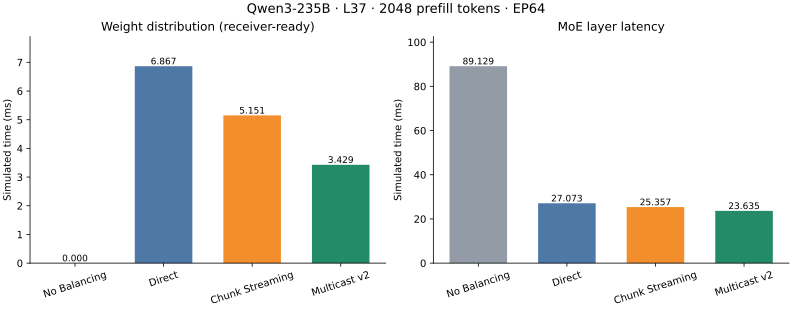
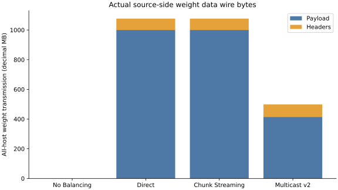
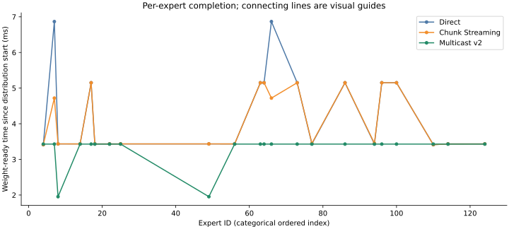

# UltraEP 集成 Multicast WRITE v2：真实 Qwen3 Prefill 对照

## 1. 结论

固定 L37 / 2048 Token / EP64 场景：Multicast 相对 Chunk 的权重分发加速比为 **1.5021×**，层时延加速比为 **1.0729×**；相对 Direct 分别为 **2.0025×**、**1.1455×**。加速比定义为对照耗时 / Multicast 耗时，小于 1 表示更慢。

全部数值来自当前统一版本的四次新运行，不混用历史结果。Payload、原生逐目标完成、全局 Weight Ready 依赖、资源排空与信用守恒检查通过。结果仅支持这一固定仿真点，不能外推到全部层、其他 Token 数、实际硬件或丢包环境。

## 2. 配置与公平性

- 真实 Qwen3-235B-A22B-FP8 L37 路由前缀：2048 Token，Top-k=8，EP64，128 Expert。
- H=4096，I=1536，三矩阵 SwiGLU；每 Expert 权重 18,874,368 B（理想 FP8，不含 scale/padding）；激活 BF16。
- 单 UB Switch，100 Gbps，20 ns 链路传播延迟；1024 B TA，4096 B relay chunk。队列、CBFC、计算模型、Token Dispatch/Combine 均不改变。
- 三种 UltraEP 策略使用同一份新 Planner 输出；plan.json 和 assignments.csv 逐字节相同。No Balancing 使用其正常基线规划。
- 计算采用既有 500 effective GFLOP/s 假设；模拟 Planner/Reroute 分别为 200/100 ns，NoBal 为 0/0。实际 Planner 宿主机测量另见 results/planner-host.json。Reroute 这里仍是原有固定延迟模型，不是新增的独立网络搬运实现。
- 无丢包性能矩阵沿用共同的 EnableRetrans=false 配置；专项故障回归启用原生 GBN。未为 Multicast 单独关闭流控、缩小权重或减少验证。
- Pair Jetty 复用，每个有向通信 Pair 一个发送 Jetty；没有按 Expert 或 TA 创建专用 Jetty/TP。

## 3. 模拟性能

| 策略 | Planner (ns) | Reroute (ns) | Weight (ms) | Dispatch span (ms) | Compute span (ms) | Combine span (ms) | Layer (ms) | 对 NoBal 加速比 |
|---|---:|---:|---:|---:|---:|---:|---:|---:|
| No Balancing | 0 | 0 | 0.000000 | 0.854802 | 88.234557 | 88.092733 | 89.129315 | 1.0000× |
| UltraEP Direct | 200 | 100 | 6.867180 | 0.216323 | 19.838164 | 8.193729 | 27.073308 | 3.2921× |
| UltraEP Chunk Streaming | 200 | 100 | 5.150959 | 0.216488 | 19.834833 | 8.190549 | 25.357403 | 3.5149× |
| UltraEP Multicast WRITE v2 | 200 | 100 | 3.429284 | 0.216355 | 19.843963 | 8.199161 | 23.635079 | 3.7711× |

Weight 是 planning_end 到最后一个副本接收端实际验证完成的时间，不是发送端 ACK 完成时间。Dispatch/Compute/Combine 的 span 可能重叠，不能逐项相加得到 Layer。最后输出完成与随后原生协议安全排空也分别检查。

## 4. 通信与 Fanout

| 策略 | 组播 Expert | Envelope | 组播单播分支 | 全部主机权重 Payload B | 全部主机权重 Wire B | Header B | Switch 下行权重 Wire B |
|---|---:|---:|---:|---:|---:|---:|---:|
| No Balancing | 0 | 0 | 0 | 0 | 0 | 0 | 0 |
| UltraEP Direct | 0 | 0 | 0 | 1,000,341,504 | 1,076,539,392 | 76,197,888 | 1,076,539,392 |
| UltraEP Chunk Streaming | 0 | 0 | 0 | 1,000,341,504 | 1,076,539,392 | 76,197,888 | 1,076,539,392 |
| UltraEP Multicast WRITE v2 | 20 | 368,640 | 940,032 | 415,236,096 | 498,401,280 | 83,165,184 | 1,076,539,392 |

“全部主机”包括 Chunk 的中继发送端，不等于仅原始 Main NPU 的注入流量。上表仅权重数据；控制反馈及所有链路总字节另见 CSV。单目标 Expert 使用原生单播，计入 Payload/Wire，但不计入 Envelope/组播分支。communication.csv 另列权重图 WQE 数与实际 Switch 下行原生权重 WRITE 分段数；每个组播子 WQE 的完成时间单独保存在 multicast-groups.csv。

Replica fanout 分布：1 个远端副本：2 个 Expert, 4 个远端副本：2 个 Expert, 2 个远端副本：11 个 Expert, 3 个远端副本：7 个 Expert。

## 5. Weight Ready 与关键路径

- UltraEP Direct：最后 Weight Ready 为 Expert 66，fanout=4，距分发开始 6.867180 ms。
- UltraEP Chunk Streaming：最后 Weight Ready 为 Expert 64，fanout=3，距分发开始 5.150959 ms。
- UltraEP Multicast WRITE v2：最后 Weight Ready 为 Expert 86，fanout=3，距分发开始 3.429284 ms。
- Multicast 最迟副本位于 NPU 0，源 NPU 43，Expert 86；该接收 NPU 共接收 2 份 Expert 权重。

最后 Weight Ready 决定既有全局 Dispatch gate（当其晚于 Reroute）。这定位的是权重阶段的门槛，不代表已证明同一 Expert 决定后续 Compute/Combine 的完整因果关键路径。各 Expert 的真实接收完成时刻、按 fanout 的观察统计、接收者 fan-in、每 NPU 的 compute 区间分别保存在 CSV。高 fanout 增加 Envelope header，并可能与共享接收端竞争叠加；本轮不改变放置或做干预扫描，因此不声称独立量化 fanout 的因果贡献。

## 6. 集成机制与生命周期

新增策略位于 layer.cc、pair-multicast-v2.h、integration.inc；原 Planner、PairJettyManager、Direct/Chunk/NoBal 执行代码未被修改。原生改动只有两个小接缝：只读观察原始待发分段，以及仅新代理启用的 RR 分配提交前重检。重检失败重新走正常 AllocationTime，不扣信用、不推进 PSN、不直接安排成功接收。

为避免共享 Pair 的多个 WQE 在 Jetty 512-TA 反压恢复后形成头部相互等待，采用整组原子获取“无向端点 Pair 集合”的首次发送准入。所有子 WQE 首次数据实际出队后释放，下一次准入通过 ScheduleNow 进行。共享 Pair 的首次发送被串行化；不共享 Pair 的组仍可并发，原生完成/重传生命周期可以重叠。这是明确的候选策略调度限制，不是无成本、无限并发的组播。

ACK、事务响应、GBN 重传以及单目标 WRITE 始终走原生单播。适配器不维护独立 ACK 表、重传定时器或可靠性状态机。WQE 完成后不立即销毁 TP；最终检查 send_una==send_nxt、无未确认/重传描述符/定时器、Jetty 无活动 WQE、关联表为空、队列为空。静态 Pair 对象留待仿真结束释放，不把“安全静止”描述为逐对象析构证据。

## 7. 正确性、故障与回归

- Stage A：8 个固定场景 × 4 策略 = 32 次正向运行。覆盖无副本、单目标、多目标、同源不同目标组、1 MiB 对象、多源共享接收者、延迟就绪、非整除 TA。真实字节校验和最终输出 hash 一致。
- 4 项负向：破坏权重字节、提前 WQE 完成、提前 Ready、重复完成，均被预期检查拒绝。
- 新共享 Pair 路径：数据尾段丢失和 ACK 丢失恢复；过期分配 grant 被拒绝并重选。数据丢失为 task64 / PSN11 / SSN11 / 1024B，仅 1 个原生单播重传，源端与交换机物理 TX 证据在 results/stage-a/network/data-once/weight-packets.csv。故障点为此前认可的完成链路/信用核算之后、进入接收 TP 之前的定向测试接缝，并非随机物理链路损坏模型。
- 独立手工原生压力测试：5 组、10 个子 WRITE、9 个 Pair Jetty；覆盖同源共享 Pair、双向冲突与不共享 Pair 并发。1 MiB/子 WRITE + 200µs 非对称事务执行延迟，实测原生在途 TA 峰值 512，最终正确排空。该测试不是 Planner 性能样本。
- 原 NoBal/Direct/Chunk：24 次新运行，与未改动旧执行器在相同原生库上的语义指标逐字段一致。
- Two-Stage：额外固定小场景的新旧执行器完整 summary（除验证宿主机计时）一致。
- v1/v2：14 个旧正向用例的字节、时序和队列指标与已验收结果完全一致；关联/反馈负向测试保留。
- 原生重传：正常、数据丢失、TP ACK 丢失、事务响应丢失 4 项旧回归通过。没有重跑完整持续丢包矩阵，也不宣称新的通用失败恢复语义。

早期真实 NoBal 已通过，但宿主机耗时 816.637s；历史 129.570s 构建关闭原生断言，而本轮保持开启。另发现本轮引入的可选 RR hook 对普通队列逐包重复扫描并复制 TypeId 属性元数据。Direct 被主动中断以重新评估运行预算，没有将其当成协议失败或有效结果。随后仅缓存每种静态 TypeId 是否存在该属性，仍逐次读取正向 getter 并保留全部原生/应用检查；最终四策略在统一缓存版原生库上重新运行，不混入首轮 NoBal。

一次早期“重叠”测试虽然网络仿真通过，却未通过结构断言：Planner 生成的是不相交接收者。该次不计入重叠覆盖。最终使用既有纯合成 EP64/N256 小模型输入验证真实 Planner 的不同源共享接收者，并用独立原生压力夹具验证更强的同源共享 Pair 情形；没有为了性能修改 Planner。

## 8. 资源与宿主机时间

| 策略 | Wall (s) | CPU (s) | Peak RSS (GiB) | 全部远端 WQE | 全部 TA | Pair Jetty |
|---|---:|---:|---:|---:|---:|---:|
| No Balancing | 380.460 | 369.070 | 0.778 | 32,246 | 257,968 | 3,976 |
| UltraEP Direct | 1645.010 | 1539.396 | 3.650 | 31,593 | 1,229,216 | 4,021 |
| UltraEP Chunk Streaming | 2772.841 | 2608.312 | 3.539 | 68,449 | 1,229,216 | 4,021 |
| UltraEP Multicast WRITE v2 | 1755.792 | 1671.538 | 3.655 | 31,593 | 1,229,216 | 4,021 |

宿主机执行时间不是模拟网络/层时延。用户在运行期间要求两组并行，因此最后 Chunk 与 Multicast 部分重叠执行，NoBal/Direct 为串行；这两组 Wall/CPU 时间受共享主机资源影响，不作严格串行运行速度对照。使用的可执行文件逐字节相同，仿真输入、原生库及各自离散事件时钟不变。各阶段均保留 3600s wall、6GiB RSS、7GiB address-space 和磁盘/可用内存保护；各策略统一 8GiB logical payload 与 1,000,000 weight-task 上限。Summary 默认日志；小型故障保留必要 Events，不发布真实逐 Token、原始 Routing Trace、Payload 或大型 Debug。

CBFC 守恒按 consumed = peer returned = restored + peer pending 检查。批量返还造成少量 pending credit 时，不把它说成所有信用都已返还到初始值。完整最终 TP/Jetty 状态与 ingress/VOQ/egress 峰值见 results/real/*/{pair-state,network-resources}.csv。

## 9. 限制与复现

- 真实输入是 Routing Trace 和模型尺寸；权重/激活 Payload 使用既有确定性校验字节，不加载真实 Qwen checkpoint 或执行真实 GEMM。最终输出 hash 一致是仿真模型的正确性证据，不是模型精度评测。
- V2 Envelope、变长 header、仿真内 metadata 关联仍是实验性模型，不宣称 UB 标准原生组播。Payload 始终来自链路实际字节；关联表只恢复元数据。
- 尚未标定真实 source coalescing、switch header parse/route/fanout/reconstruction 的硬件处理成本。只保留原有网络服务、队列、CBFC 与链路时间模型。
- 新代理仅支持当前 RR allocator；不宣称已支持 DWRR 集成。原 v2 DWRR 微测回归仍是其旧路径，不是新 paired executor 的能力。
- 原生持续重试耗尽仍可能断言停止，并非逐 WQE 优雅失败；本轮未重设计协议。
- 只运行真实 L37/2048 Token 这一个点。没有扩大到 4096 Token、94 层、Decode、训练或多交换机。

源码、两项原生补丁、固定输入 hash、复现入口和执行边界见 [README](README.md)、[输入与预算](INPUTS-AND-BUDGET.md)、[源码来源](source-provenance.json)、[执行记录](run-ledger.md)。结果表和图均由 collect.py / plot.py / report.py 从已通过验证的私有运行产物生成。
